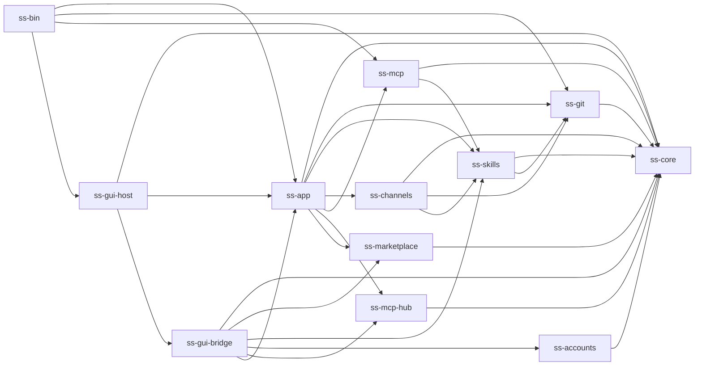

# SkillStar 项目边界

状态：active

本文件是项目树、目录所有权、依赖方向与跨层接缝的单一事实来源。运行时数据流和技术选择见 [architecture.md](./architecture.md)。

## 项目树

```text
SkillStar/
├── src/main.rs                  # package ss-bin（产出二进制 skillstar）：MCP、askpass、CLI、GUI（委派 nsh 宿主）
├── .cargo/config.toml           # 无 rustflags（Apple link flag 会破坏 panic 展开，见 errors.md 2026-11-15）
├── .claude/                     # 项目级 Claude 配置与本地 skill 入口
├── .github/workflows/           # 跨平台 CI 与发布
├── crates/
│   ├── ss-core/          # 共享契约、配置与基础设施
│   ├── ss-git/           # Git transport/ops/tree/history 叶子
│   ├── ss-accounts/      # 账号能力：OAuth 登录/令牌、额度抓取、加密存储、切号写回与对账（唯一对 UI 的 facade）
│   ├── ss-marketplace/   # 本地技能市场快照与 FTS
│   ├── ss-skills/        # 技能生命周期、频道所有权注册表（channel_registry）、项目部署与 Agent profile
│   ├── ss-channels/      # 组织私有共享频道：GitHub REST、发布、订阅、升级、回滚与 marketplace 导出
│   ├── ss-mcp/           # 本机项目技能 MCP stdio 服务（rmcp）与 CLI 批准入口
│   ├── ss-mcp-hub/       # 外部 MCP Server 无损管理、内置商店与 35 个 Agent 配置同步
│   └── ss-app/           # 跨域 use case、CLI 解析、进程启动与周期唤醒
├── gui/                  # 唯一 GUI：TSX 前端 + host（ss-gui-host）+ native（ss-gui-bridge）
├── docs/                        # 架构边界、关键决策与领域功能活文档
├── scripts/internal/            # CI 棘轮和一致性检查
└── Cargo.toml / Cargo.lock / deny.toml
                                  # 根 Cargo.toml 同时是 workspace 与 package ss-bin（二进制 skillstar）；唯一 lockfile、cargo-deny 配置
```

GUI 栈是 nsh（`nsh` CLI 与 `nsh-core` / `nsh-base` 及各平台 AppView 宿主 crate，版本与 CLI 同步锁定）；仓库不携带任何 vendored crate。

## Workspace crate 所有权

| Crate | 拥有 | 不拥有 |
| --- | --- | --- |
| `ss-core` | 路径、文件操作原语（不含技能部署语义）、旧数据根迁移、共享错误和配置、HTTP client（`probe_http_client` / `probe_http_client_no_redirect`）、翻译引擎与缓存、共享 `Skill` 契约 | 任一产品域的业务流程；SQLite 连接池（`db_pool` 已删除） |
| `ss-git` | Git 子进程 transport（认证材料、代理、取消、进度、脱敏）、临时目录浅克隆与 ref/folder tree-hash 等操作级 Git 辅助、repo history | 依赖 content/lock/channels 的 GitHub 仓库管理（`gh_manager` 留在 `ss-skills::git`） |
| `ss-accounts` | 账号工作台全能力：`Account` 记录与 AES-256-GCM 加密存储、OAuth 登录与令牌刷新（`pub(crate) mod oauth`）、每家 agent 额度抓取与快照模型（`pub(crate) mod usage`）、切号写回（`switch`）与客户端实况对账（`reconcile`）；唯一对 UI 暴露的 facade（只出 `AccountView`，凭据不出 crate） | Agent 注册表定义（以 `ss-skills` id 字符串传递）、共享频道/GitHub 身份、UI 布局 |
| `ss-marketplace` | SQLite 快照（`rusqlite` 短连接/WAL）、FTS、技能市场远程拉取与公开仓库安装前安全审计 | 技能安装实现（仅保留历史表迁移兼容） |
| `ss-skills` | skills CLI 语义安装核心（[D-081](./decisions.md#d-081技能安装锁与更新整体同步-vercel-labsskills删除自研管线)：`skill_lock` 锁、`fetch` 临时浅克隆、`installer` canonical 复制、同名异源 `<name>-<owner>` 自动并存与同源折叠、`materialize` 名字换算（含非 ASCII 回退）/受限复制/暂存交换原语（[D-094](./decisions.md#d-094技能物化统一为校验暂存交换原语部署所有权由链接目标或部署标记证明)）、`update` 按来源分组拉取与自动迁移运行期依赖目录的覆盖式重装/后台自动更新用例、`update_check` 上游 tree SHA 检测与同仓新增技能扫描（`update_api` 支持 ETag 条件请求缓存、限流冷却、有界并发）、`library` 统一技能管理树（`data/skills/library.json`）、`backup` 滚动备份与恢复（`data/skills/backups/`）、`runtime_ignore` 统一运行期依赖产物排除与携带、`install_baseline` 安装内容基线、`repo_favorites` 本机仓库收藏、`installed_skill` 读侧）、bundle、本地创作、`GitSkillFacade`、GitHub 仓库管理（`git::gh_manager` 编排 + `git::gh_rest` 发布 REST）、项目 manifest 与副本维护（`projects`）、deployment（`deployment::ownership` 与 `deployment::shared_coord` 是部署所有权、全局/单 Agent Link/Copy 模式、`CopyModified` 回流/备份覆盖、`~/.agents/skills` 引用计数协调与 Windows junction 防护的唯一实现）；SKILL.md frontmatter 解析、name 回写与诊断（`validation`）、安装门禁、`update_api`；`skill_mutation` 变更门禁接缝与 `channel_registry`；Agent spec/registry/custom profile 与部署模式偏好存储（`agents`）；GitHub App 认证（`github_auth`）；本机团队智能（`team`）；单域部署/链接用例（`workflows`）；存储健康检查与修复（`health`） | Marketplace 搜索、Usage、共享频道远程编排（在 `ss-channels`） |
| `ss-channels` | 组织私有共享频道全编排：GitHub 频道创建（`SharedChannelFacade`）与已有仓库注册（`ExistingChannelRegistrationFacade`）、不可变 Release 预览与发布（`ChannelPublicationFacade`）、成员与邀请（`ChannelMembershipFacade`）、订阅安装与受保护自动/手动升级（`ChannelSubscriptionFacade` / `ChannelSubscriptionUpdater`）、单 Skill 历史回滚、移除转本地副本（`ChannelRemovedSkillHandler`），以及纯本地只读 marketplace 导出（私有模块 `plugin_market_format`，[D-104](./decisions.md#d-104claude-code-插件市场格式收回-ss-skills-私有模块)）；通过 `ss-skills::channel_registry`（并重导出）与 `ss-skills::materialize` 操作本地存储 | 通用技能安装锁/变更策略默认实现（留在 `ss-skills::channel_registry`）、GUI 定时唤醒（`ss-app::channel_wake`）或独立用户 ACL |
| `ss-mcp` | 本机项目技能 MCP stdio 服务（`serve` / `serve_with` / `is_mcp_serve` / `is_mcp_invocation`，独占 `rmcp`）、Grok `2025-11-25` 兼容网关、form elicitation 确认、计划生成/批准/回执（`plan` / `approval` / `apply` / `inspect` / `ranker` / `recommend`），以及 CLI `mcp approve` 执行入口（`run_approve`） | 市场快照初始化、跨域 CLI 分派（仅在 `ss-app` 提供 `mcp` 子命令壳）、外部 MCP 客户端管理与内置商店（在 `ss-mcp-hub`） |
| `ss-mcp-hub` | 外部 MCP Server 全生命周期管理（`data/mcp/library.json`、`runtime/locks/mcp/library.lock`、`data/mcp/backups/`）、35 个内置 MCP Agent 目标探测与多格式编码（24 种 `McpFormat` + 10 种项目片段）、三层无损入侵编辑（JSON/JSONC span 保留与注释/尾逗号保护、TOML 表区间保留、YAML/DSH patch 区块保留、BOM/CRLF/symlink/hardlink/滚动备份、字段级所有权合并与 Zed 扩展条目守卫、仅改台账条目）、Agent 已有 MCP 发现/无损纳管/有备份移除、粘贴解析、`tools/list` 连通性探测与工具禁用，以及内置 MCP 商店（精选列表、离线 `market_servers.json` 快照与经 `probe_http_client` 访问的在线 Registry 搜索） | 本机项目技能 `rmcp` stdio 服务（在 `ss-mcp`）、Skill 部署/账号存储、GUI 布局 |
| `ss-app` | 需要多个域协作的 use case（含 `channel_ops` 共享频道读写/发布/成员/订阅编排与 `project_skill_approval` 项目技能计划查询/批准桥接）、CLI 解析（含 `cli::update` 先检查后应用、`cli::backups` 历史快照管理、`cli::doctor` 存储健康与纳管、`cli::channel` 完整频道子命令、`cli::mcp_approve` 转发 `ss_mcp::run_approve` 与 `cli::mcp_hub` 外部 MCP 管理命令）、进程启动（迁移 + 旧 hub 链接修复 + 市场快照接线）和 GUI 存活期间的周期唤醒（`channel_wake` 频道自动升级、`skill_wake` 通用技能自动更新、`release_check_wake` 应用版本检查；生产频道 facade 由 `channel_facade` 统一构造） | 窗口对象、`rmcp` 与 MCP stdio 协议（在 `ss-mcp`）、单域账号/额度/登录（在 `ss-accounts`）、单域技能部署用例；不拥有健康计划或纳管计划，只调用 `ss-skills` 的对应 facade |
| `ss-gui-bridge` | `gui/native` 的 `#[native_module("skillstar-gui/native")]` 原生桥接：把 `ss-core` / `ss-marketplace` / `ss-skills` / `ss-accounts` / `ss-mcp-hub` / `ss-app`（如 `my_skills_channels.rs` 调 `ss_app::channel_ops`、`projects.rs` 调 `ss_app::project_skill_approval`）的域 facade 封装为 TSX 可调用异步/同步接口、`DomainJob` 取消句柄、`popover_dismiss.rs`（macOS 额度弹出窗失焦监听）与多枚智能体品牌 SVG/头像资源 | 页面布局、响应式状态或绕过域 facade 的文件/网络业务读写 |
| `ss-gui-host` | `gui/host` 的桌面 AppView 原生宿主（`run`，macOS AppKit / Windows Win32 各一份，D-115）：初始化日志、调用 `ss_app::bootstrap::{prepare_process, spawn_gui_background}`，嵌入 `nsh build` 产物 `bundle.js` 并注册 `ss-gui-bridge`；配合壳层 `background_run` 控制关窗隐藏保活或退出 | TSX 页面视图、窗口内交互逻辑（关窗与托盘/状态栏弹出窗语义在 `src/shell/residentWindow.ts` 与 `trayQuotaWindow.tsx`）或 CLI/MCP 进程分派 |
| `ss-bin` | 根 package（`src/main.rs`，产出唯一产品二进制 `skillstar`）的进程分派：先 `ss_mcp::serve()`，再 `ss_git` askpass，再 `ss_app` CLI，其余委派 `ss_gui_host::run` | 域逻辑、窗口实现 |

## GUI 壳（nsh）

GUI 唯一实现为 nsh 应用 `gui/`，分三层且职责单向依赖：

```text
gui/
├── App.tsx            # ready gate + Shell 挂载；窗口 chrome 在 nsh.json 的 window 键
├── assets/            # 应用图标（icon.svg 矢量母版、icon.png、Windows 用的 icon.ico、状态栏单色模板图标 tray-icon.svg）与 83 枚智能体品牌 SVG（agents/*.svg）
├── src/shell/         # Shell（页面保活 display 切换）、Sidebar（含底部 GitHub 状态入口）、nav、事件总线、residentWindow（受 background_run 控制隐藏或退出）与 trayQuotaWindow（状态栏/托盘额度弹出窗）
├── src/pages/         # 技能/市场/卡组/项目/MCP/账号/设置七个页面，每页一个目录（MCP 挂入 Skills 侧栏组，顶层仍只保 Skills/Accounts 两模式）
├── src/chrome/        # 跨页共用控件（分段控件、卡片骨架、仓库头像、智能体底栏 rail、弹窗外框、工具栏、Toast）
├── src/services/      # themeMode（palette token）、locale、translation、domainJob
├── host/              # AppView 原生宿主 ss-gui-host（内嵌 bundle.js、macOS Dock 图标与 Windows 任务栏图标）
└── native/            # 桥 crate ss-gui-bridge：各域 facade 的 #[native_module("skillstar-gui/native")]
```

页面之间不互相 import；跨页跳转走 `src/shell/events.ts` 的事件，由 `Shell` 改路由。
桥 crate 只做「TSX 入参 -> 域 facade -> 可序列化结果」，页面状态与布局留在 TSX。
视觉与交互契约见 [features/frontend/README.md](./features/frontend/README.md)
与各功能文档；账号页的卡片契约在 [features/accounts/README.md](./features/accounts/README.md)。

## 当前功能的域划分

按数据所有权和事务内聚性划分，不按页面数量建 crate。Skills（`ss-skills`）拥有技能安装、更新、部署、项目 manifest、Agent 注册表与频道所有权注册表（`channel_registry`）；组织私有共享频道的远程编排、发布与订阅升级独立在 `ss-channels`（消费 `ss-skills::channel_registry` 接缝）。Accounts（`ss-accounts`）统一承载 OAuth 登录与刷新（`oauth`）、额度抓取（`usage`）、加密存储（`store`）与切号对账（`switch` / `reconcile`），内部按 `agents` 单表驱动维护受管清单（以 `ss_accounts::Agent::supported()` 为准），对外统一暴露 `AccountView` 与顶层 facade；仅管理账号而无技能同步目标的客户端可以不进入 Skills 注册表。本机项目技能 MCP 服务独立在 `ss-mcp`（隔离 `rmcp` 与早期 stdio 启动路径）；外部 MCP Server 的无损配置同步、35 个 Agent 适配与内置商店独立在 `ss-mcp-hub`（独占 TOML/JSONC/YAML/DSH span 级无损编辑器与 `data/mcp/` 账本，不介入项目技能 stdio 热路径）。

Marketplace 保留独立 SQLite 快照/FTS 生命周期；Git 保留传输依赖与取消/认证边界。SKILL.md 解析留在技能域的私有模块，通过 `validation` 暴露统一接口（D-099）。`ss-app` 只组合真正跨域的流程、CLI 入口与后台唤醒，不为单域操作增加转发层。

## 允许的依赖方向

当前 Cargo 依赖形成以下单向图：



禁止：

- `ss-core` 依赖任一产品域。
- `skills ↔ marketplace`、域 crate → `ss-bin` / `ss-gui-host` / `ss-gui-bridge`。
- 壳或 CLI 为绕过边界而直接拼装跨域事务。
- leaf crate 用 default feature 隐式决定最终二进制的重 feature；由 `ss-bin` 显式选择。

依赖方向由 `Cargo.toml` 和 `scripts/internal/check_workspace_deps.sh` 共同看门；本文件不维护依赖版本。
Cargo 只使用仓库根 `Cargo.lock`；workspace member 下出现嵌套 lockfile 由同一 guard 拒绝。

## 壳与进程边界

- 页面之间不互相 import；跨页跳转走 `src/shell/events.ts` 的事件，由 `Shell` 改路由。
- 应用文案在 `gui/src/services/translation.ts`，`en` 与 `zh-CN` 两套字典必须同步维护。
- `ss-skills::fetch` 的私有 `fetch/cache.rs` 管理普通导入的持久缓存与互斥，`fetch::clear_import_cache` 向存储维护暴露清理入口；完整快照仍用临时 checkout。
- Settings 可以组合各域的公开设置入口，但不复制域逻辑。GitHub 设备授权、凭据和网络状态机仍由 `ss-skills::github_auth` 拥有。
- 本机 Agent 已装技能的纳管计划由 `ss-skills::local_skill` 的私有 `intake` 模块拥有；`repair` 只把 `repair_installations` 委托给该计划。`doctor --fix` 与设置里的修复按钮不调用它。`doctor --adopt` 与设置存储页的预览/纳管调用它。存储维护的显式 `repair_skills` 只跑这条纳管计划，断链清理留在 `clean_broken_skills`；GUI 只展示逐项结果。
- `ss-skills::git_skill` 是扫描、安装、更新检查和升级的展示无关入口；`ss-git::transport` 独占远程 Git 子进程的认证、代理、取消、进度和脱敏策略，仓库内容获取统一走 `ss-skills::fetch`（行为见 [Skills](./features/skills/README.md#安装与更新)）。`ss-skills::git::gh_manager` 因耦合 content/共享频道安装器留在 skills，`skills::git` 对 `ss-git` 仅 re-export。发布链路的 GitHub REST 独占在 `skills::git::gh_rest`（App 凭据 + `probe_http_client`），`gh_manager` 只做编排；发布的 clone/pull/push 必须经 `ss-git::transport` 的 operation session，本地 init/add/commit 才允许裸子进程。CLI 与 GUI 不得另起带网络的 Git 命令。
- `ss-channels` 独占共享频道 GitHub REST 编排、权限投影、版本化 descriptor、本地登记、成员/邀请 facade、已有仓库 registration session、不可变 release manifest/publish session，以及版本化 subscription store、精确发布安装、逐 Skill 频道升级事务、按频道自动升级到期/暂停策略和 marketplace 导出编排（格式 schema 与目录写出在 `ss-channels` 私有模块 `plugin_market_format`，[D-104](./decisions.md#d-104claude-code-插件市场格式收回-ss-skills-私有模块)）；仓库库存、发布快照和订阅内容扫描只能经注入的操作级 Git scanner/installer/updater 接缝，生产 REST gateway 必须使用 `probe_http_client`。成员与 invitation 不得另建持久 ACL，订阅选择、自动升级偏好和升级结果不得写入 GitHub。本地只读状态与偏好直接访问 `ss-skills::channel_registry`（由 `ss-channels` 重导出）的 subscription registry，不得被登录状态阻断。应用进程内的周期唤醒属于 `ss-app` 的 `channel_wake`，由 GUI 进程启动，不得复制成壳内计时器。完整共享频道管理操作同时覆盖 CLI（`skillstar channel`）与 GUI「我的技能 → 频道」工作区（经 `ss-app::channel_ops` 与 `MySkillsChannels` 原生桥暴露）。
- 通用技能自动更新偏好由 `ss-core::config::skill_updates` 拥有（Settings 只读写它），检查与应用用例在 `ss-skills::update`，GUI 存活期间的周期唤醒在 `ss-app::skill_wake`；壳不自己计时，也不复制更新事务。
- 通用技能 mutation gate 保留窄查询接口，默认使用域内 `ss_skills::channel_registry::policy::ChannelAwarePolicy` 查询订阅注册表；无需 GUI/CLI 注册，直接调用技能域也不能绕过频道所有权保护。测试直接验证生产默认策略；不再公开可替换的全局策略注册口。
- 顶层模式只有 Skills 与 Accounts 两个（见 [D-085](./decisions.md)）：Usage 与 OAuth 已并入 `ss-accounts`，账号增删改切与消费展示都只在 Accounts 出现。
- MCP serve（`ss_mcp::serve`）不得调用 `ss_app::bootstrap::prepare_process`。市场快照初始化不属于 stdio 握手。

## 关键接缝

| 接缝 | 规则 | 证据入口 |
| --- | --- | --- |
| `GUI → 域` | TSX 视图经 `gui/native`（`ss-gui-bridge`）的 `#[native_module("skillstar-gui/native")]` facade 调域逻辑，不经 IPC | `gui/native/src/lib.rs` |
| 进程入口 | `ss-bin`（二进制 `skillstar`）先判断 `ss_mcp::is_mcp_serve`，再 askpass，再 CLI，其余进入 `ss_gui_host::run` | `src/main.rs`、`gui/host/` |
| 进程启动 | CLI 与 GUI 共用迁移和市场快照接线；MCP serve 不调用 | `crates/ss-app/src/bootstrap.rs` |
| 跨域事务 | 放入 `ss-app`，由窄 facade 组合 | `crates/ss-app/src/` |
| 频道所有权接缝 | 持久化注册表、`ChannelInstallAuthority`、schema 与默认变更守卫在 `ss-skills::channel_registry`，远程编排/发布/升级/回滚/导出在 `ss-channels` | `crates/ss-skills/src/channel_registry/`、`crates/ss-channels/src/` |
| 技能自动更新 | 偏好归 `ss-core` config，检查与应用归 `ss-skills` facade，周期唤醒归 `ss-app`；壳只读写偏好 | `crates/ss-app/src/skill_wake.rs` |
| 项目复制同步与恢复 | `ss-skills::projects` 的私有 upkeep 模块在同一锁快照读取 manifest、规则与部署状态，刷新副本及清理跟踪记录；`gui/src/pages/projects/` 经桥接展示状态、重试和路径重关联 | `crates/ss-skills/src/projects/upkeep.rs`、`crates/ss-skills/src/projects/refresh.rs`、`gui/src/pages/projects/` |
| 应用版本检查 | 检测归 `ss-core::infra::release_check`（check-only，不下载），周期唤醒归 `ss-app`，产品版本由根 `Cargo.toml` 的 `[package]`（`ss-bin`）传入（D-103） | `crates/ss-core/src/infra/release_check.rs` |
| 项目技能 MCP | 本机 stdio 服务、项目技能推荐、批准编排与 CLI `mcp approve` 入口在 `ss-mcp`（`ss_mcp::serve` / `run_approve`）；桌面 `Projects` 页经 `ss_app::project_skill_approval`（`pending_project_skill_plan` / `approve_project_skill_plan`）与桥接 `projects.rs` 展示待批准计划并触发批准。工具参数在 `ss_mcp::protocol`，不接收批准字段。`rmcp` 只加入 `ss-mcp` | `crates/ss-mcp/src/`、`crates/ss-app/src/project_skill_approval.rs`、`gui/src/pages/projects/pendingPlanCard.tsx` |
| 外部 MCP 管理 | 外部 MCP Server 无损管理、24 种配置格式同步、35 个 Agent 适配与内置 MCP 商店在 `ss-mcp-hub`，不依赖 `rmcp` 与 `ss-skills` | `crates/ss-mcp-hub/src/`、`docs/features/mcp/README.md` |
| 网络 | 经统一 HTTP client，读取 proxy 配置 | `crates/ss-core/src/infra/http_client.rs` |

## 新代码放置决策

1. 只影响一个现有域：先放该 crate/feature 的私有 module。
2. 多域业务事务：放 `ss-app`，不要制造反向依赖。
3. 仅界面或 `nsh` 前端展示：放 `gui/src/pages/` 对应页面目录；第二个页面复用、且能独立命名时抽到 `gui/src/chrome/`。
4. 仅进程分派，不含域逻辑：放仓库根 `src/main.rs`（package `ss-bin`）。
5. 真正跨域且无业务语义的基础能力：才考虑 `ss-core`。
6. 只有变更节奏、依赖集合或 deletion test 证明独立编译单元有收益时，才晋升为新 crate。
7. 外部技术规范（如 Agent Skills frontmatter）若满足 D-002，可成为产品无关协议叶子；不得把产品编排塞进该叶子。

## 变化触发器

新增、移动、删除顶层目录、workspace member、GUI 宿主/桥接目录（`gui/{host,native}`）或公开接缝时，必须先更新本文件，并同步更新 [architecture.md](./architecture.md) 中受影响的数据流。
