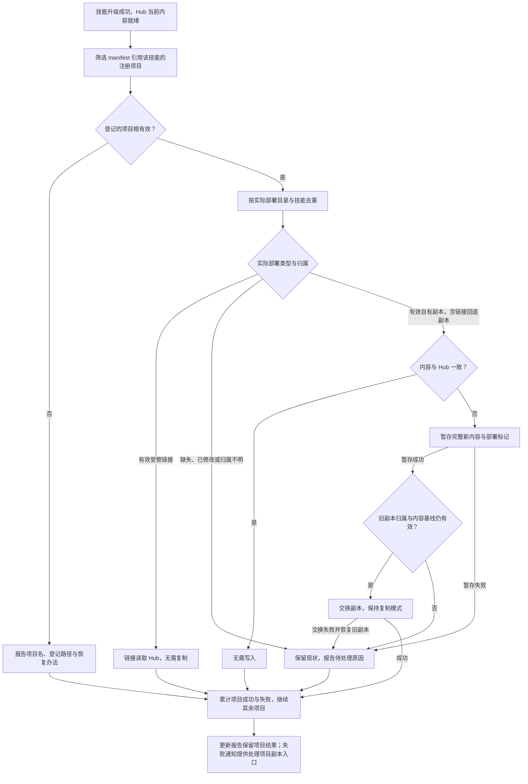
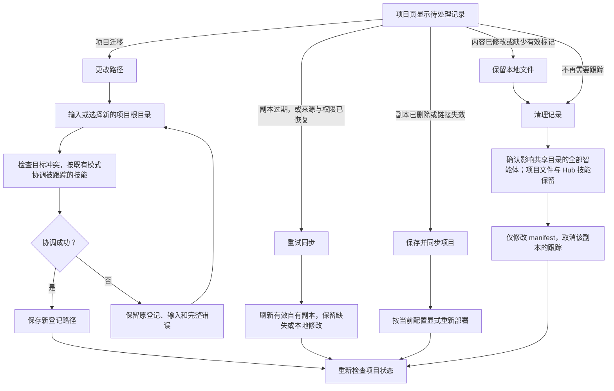

# Skills、Projects 与共享频道

状态：active

本文件是技能安装、Agent 注册与手动启用、项目检测、部署、bundle、共享频道行为契约和相关 UI 行为的单一事实来源。新增内置 Agent 的操作步骤见 [../agents/README.md](../agents/README.md)。

## 所有权

- `ss-skills` 拥有技能 install/update/bundle/local/repo scan、安装锁/update detection、Agent registry、项目 manifest、deployment 与频道所有权注册表（`channel_registry`）。组织私有共享频道的远程编排、发布、订阅/升级/回滚与 marketplace 导出独立在 `ss-channels`（消费 `ss-skills::channel_registry`）。无消费者的旧 terminal backend、`patrol` 模块与 `workflows::global_deploy` 不再保留。
- `ss-core` 只提供共享 `Skill` 契约与基础设施，不拥有技能安装锁/update detection。
- GUI 和 CLI 都调用同一 facade。壳不复制安装事务。
- 搜索结果安装等跨 marketplace/skills 流程由 `ss-app` 编排。
- 技能组与 Agent 链接编排（`set_deck_agent` / `link_deck_to_enabled_agents`）由 `ss-skills::workflows::skill_group_links` 持有；无调用方的 `ss-app::skill_group_deploy` 已删除。
- `ss-skills::content` 是技能内容读取、文件枚举、本地创建/删除和嵌套内容目录解析的 facade；壳不直接组合 canonical 路径、安装锁与 cache invalidation。内容 facade 对外部输入先执行 `validate_skill_name`，再 canonicalize 有效目录并限制在 canonical skills 目录或本地创作目录内；外部符号链接不会被 read/list/open 跟随。只读快照（有效内容根、递归文件清单和确定性内容 hash）服务频道基线校验。通用技能会不会被自动覆盖，由安装基线判断，见[生命周期](#生命周期)。
- `ss-skills::update` 拥有通用更新路径（[D-081](../../decisions.md#d-081技能安装锁与更新整体同步-vercel-labsskills删除自研管线)）：按锁的 source+ref 分组对比上游 tree SHA。手动更新在 tree 变化时覆盖式重装；自动更新在事务锁内、覆盖前复核安装基线。规则见[生命周期](#生命周期)。`update_skill(s)` 返回完整公开结果，command 不从底层 outcome 二次拼装 `Skill` DTO。
- `ss-skills::update_state` 是 `update_available` 的唯一所有者；保存每技能 `update_available/upstream_change/checked_at` 投影，批量 refresh 和 update 完成都写穿它。批量检查开始前取时间戳（`stamp`），结束后只写入此后没有被更权威结果（`record`，如更新完成）覆盖的条目（`commit_scan`），慢检查不能把刚完成的更新改回「可更新」。
- 本地目录 adoption、share-code 安装和 deploy-status 检查同样由 Skills 域公开 use case 完成；command 只保留 blocking 调度与 `AppError` 适配。

## 生命周期

获取、安装、维护、监测、修复、升级，以及把本机 Agent 已装技能纳管进来，共用下面这一组不变量。[D-094](../../decisions.md#d-094技能物化统一为校验暂存交换原语部署所有权由链接目标或部署标记证明) 到 [D-097](../../decisions.md#d-097本机-agent-已装技能经可预览的纳管计划进入-skillstar) 分别记录物化与所有权、更新与频道升级、存储健康、本机纳管；合在一起的选择是 [D-098](../../decisions.md#d-098技能生命周期不变量)。复制上限、排除名和 Agent 清单以代码常量为准，这里不手抄。

### 来源变成规范副本

- 来源经 `Source::parse` 解析（内含 `parse_install_input` 自动剥离粘贴的 `npx/bunx/pnpm dlx/yarn dlx skills add` 或 `skillstar install` 命令行参数并提取 `--skill` / `--ref`），内容经 `ss-skills::fetch` 进入 checkout。普通导入可以复用按仓库与 ref 隔离的缓存（[D-090](../../decisions.md#d-090技能扫描与添加按需获取内容)、[D-092](../../decisions.md#d-092导入复用本地-git-缓存并锁定预览提交)）。发现 `SKILL.md` 之后，落盘名经 `materialize::resolve_canonical_skill_name` 换算：优先按共享折叠规则折叠 frontmatter `name`，若结果为空或非 ASCII（如中文 `name`），自动回退使用源文件夹目录名经安全化折叠的结果。
- 规范副本统一为 `~/.skillstar/data/skills/installed/<name>` 上的真实实体目录（[D-100](../../decisions.md#d-100已安装技能的规范副本放在-skillstar-数据根)、[D-113](../../decisions.md#d-113skillstar-v4-目录树收敛统一技能管理树部署协调与版本保护升级)）。本地创作、本机纳管、bundle、Git 与频道来源全部直接写入同一规范目录根，取消 `data/skills/local/` 双跳软链；本地创作与纳管以 `library.json`（`origin: local`）及 `.skillstar/identity.json` sidecar 标识。`~/.agents/skills` 是部分 Agent 共用的全局目录，遵循引用计数与双重加载协调。
- **同名异源并存与同源折叠**：若规范库已有同一 `source` 的技能（含仓库内目录迁移场景），复用原落盘名原地更新；若规范库同名目录已被不同来源（另一仓库、本地技能或频道）占用，自动重命名为 `<name>-<owner>`（若仍占用则追加 `-2` 等序号），并在提交暂存目录时同步改写 `SKILL.md` frontmatter 的 `name` 为该并存名防 Agent 冲突，同时在 `library.json` 记录原始名 `called`。

### 落盘

- 历史 `data/skills/local/<name>/` 与 `installed/<name>` 软链跳板会在启动迁移中无损迁入 `data/skills/installed/<name>/`，并同步重绑 Agent/项目链接，见 [存储迁移语义](../../storage-layout.md#迁移语义与-v3--v4-映射已实施)。
- 唯一写入原语是 `ss-skills::materialize`（[D-094](../../decisions.md#d-094技能物化统一为校验暂存交换原语部署所有权由链接目标或部署标记证明)）。复制目录时由 `ss-skills::runtime_ignore` 统一忽略运行期依赖与缓存目录（`.git`、`.skillstar`、`node_modules`、`.venv`、`venv`、`__pycache__` 等）；更新覆盖旧版时，自动将旧目录中存活的运行期依赖目录（`node_modules`/`.venv`/`venv`）迁入新版本，避免重复安装依赖。
- 滚动备份与恢复：卸载技能、手动覆盖有本地内容修改的技能、或解决 Copy 副本修改冲突时，先由 `ss-skills::backup` 将旧版本（排除运行期巨型依赖）归档到 `data/skills/backups/<ts>-<reason>/`（默认滚动保留最近 25 批），再执行卸载或暂存交换；支持通过 CLI (`skillstar backups`) 或设置存储页浏览并恢复历史快照。
- 卸载先确认锁可写，再持有同一把事务锁，先清理受管部署，然后先归档到 `backups/` 再删除规范目录与锁/`library.json` 条目。频道移除转本地副本（`preserve_installed_copy`）先写至 `.preserve-staging/` 临时暂存区，待频道卸载完成后自动落位至 `installed/<local_name>`。

### 部署所有权、模式与共享协调

- `profiles.toml` 支持持久化全局 `default_deploy_mode`（`symlink | copy`）与逐 Agent 覆盖 `agent_deploy_modes`，切换时支持自动重调存量受管部署；Windows 平台下 `antigravity` 与 `crush` 标记禁用 junction 回退，无符号链接权限时自动降级为受管 Copy 部署。
- Agent 路径上是不是 SkillStar 的，只有 `deployment::ownership::owned_deployment`。链接必须正好指向规范根下同名目录，断链仍算自有待清理。复制部署使用 `.skillstar-deploy.json`（含 `treeMaxMtimeMs` 与 `fileCount` 快路校验，跳过运行产物目录）：未修改则返回自有最新状态；若仅正文内容变化但 `.skillstar-deploy.json` 仍属当前技能，识别为 `SkillStarModifiedCopy`，自动更新或批量重部署均予以跳过保护，并在详情抽屉提供「回流修改到库」与「备份后覆盖」两个显式操作。
- **共享 `~/.agents/skills` 协调（`deployment::shared_coord`）**：`library.json` 维护每技能的 `desiredAgents` 期望集合。多 Agent 共用 `~/.agents/skills` 时，取消其中单个 Agent 只删除期望集合记录，仅当所有共用该物理目录的活跃 Agent 均取消时才删除物理条目；对于除了私有目录外还会扫描 `~/.agents/skills` 的 Agent（如 `cursor`、`gemini-cli`、`droid`、`opencode`），当 `~/.agents/skills/<name>` 已启用且激活时自动抑制在其私有目录写入重复副本，并在共享入口关闭时自动补回私有目录，防止 Agent 双重加载冲突。

### 锁

- 安装来源只有 `~/.skillstar/data/skills/.skill-lock.json` v3，读写都在 `skill_lock`。启动时把原先的 `~/.agents/.skill-lock.json`（以及 `$XDG_STATE_HOME/skills/.skill-lock.json`）迁到这里，新锁已存在则保留新锁。字段与 skills CLI 互通：`source`、`sourceType`、`sourceUrl`、`ref`、`skillPath`、`skillFolderHash`（git tree SHA）、`installedAt`、`updatedAt`。磁盘上的 ref 键是 `ref`，读取同时接受以前的 `gitRef`。`lastSelectedAgents` 按 camelCase 写出，也接受旧的 snake_case。未知顶层字段、未知条目字段和无法解析的条目原样保留。未知 `sourceType` 读成 `unknown`，不参与更新。
- 条目键经 `folder_for_key`（与 `canonical_skill_name` 相同）对应目录；`entry_for_folder` 按目录找回条目。`upsert` 合并同一目录旧键上的未知字段，并保留最早的 `installedAt`。同名再装是覆盖安装并改写来源，没有跨源拒绝。tree URL 的 ref 与 subpath 记在锁的 `ref` 和 `skillPath` 里，没有单独的 pinned 标志。
- 读侧（列表、徽标）对缺失、过旧、过新和损坏都展示为空锁，不改文件。写侧经 `mutate`：持 `runtime/locks/skills/skill-lock.lock`，持锁后重读，再原子替换。缺失视为空锁。旧 schema 备份后从空锁重写。版本过新或解析失败先备份，再拒绝写入，不得用空锁覆盖。安装和卸载在改规范目录之前调用 `ensure_writable`；写失败则本次回滚。显式恢复才调用 `reset_after_backup`。
- 设置里的「删除已安装技能」在第二次确认前，用和执行相同的名单（`storage_maintenance::preview_force_delete_installed_skills`）。名单仅包含当前 schema 可直接使用的锁里、来源不是 `unknown` 且不是本地创作的技能；本地创作技能（`local`）予以保留，不被 Hub 重置误删。删除前统一归档至 `backups/`。锁过新或损坏时，预览和删除都中止，确认框列不出名字。结果返回实际卸载、失败和保留的名字。

### 事务锁

- 跨进程技能事务锁是 `runtime/locks/skills/update.lock`（`skill_update::acquire_update_transaction_lock`）。同一线程可以重入，频道安装再调用通用安装器不会把自己卡死。其他进程排队。
- 安装、更新、频道升级和发布把网络放在这把锁外面：先拉取和校验，持锁后重新核对锁条目（来源、ref、路径）；自动更新同时复核规范副本仍等于安装基线，不一致或基线缺失则保留规范副本。复核通过才做暂存交换和写锁。发布的本地预检用 `try_acquire_update_transaction_lock` 限时等待；clone、pull、push 在释放之后。频道精确 Release 的拉取和 hash 校验同样在锁外。失败直接返回，不改规范副本。
- 存储修复和纳管的 `apply` 为整份计划持有这把锁。修复里按锁重装，因此会在持锁期间拉取。这不是第二把锁。`--dry-run` 和纳管预览走同一组检查，不写技能内容。

### 更新、本地修改与自动更新

- 检测在 `ss-skills::update_check`（[D-081](../../decisions.md#d-081技能安装锁与更新整体同步-vercel-labsskills删除自研管线)、[D-095](../../decisions.md#d-095更新检测按-tree-逐层解析安装基线保护自动更新频道升级由类型化授权与本地备份承担)）。按锁的 `sourceUrl+ref` 分组；`ref` 为空时比较远端 `HEAD`。`github.com` 先把 ref 解析成 commit，再取该 commit 的根 `tree.sha`；GitHub Commits/Trees 响应支持 ETag（`304 Not Modified`）磁盘缓存于 `cache/github-trees/` 减少配额消耗，并顺带通过已读取的 Tree 清单在零额外请求下发现同仓未安装相邻技能（`update_state::beside_skills`）。commit SHA 不是 tree SHA，见 [错误记录](../../errors.md)。嵌套 `skillPath` 逐层读父 tree，同一仓库的多条路径共享已经读过的 tree。只有父 tree 已经读到、并且确实没有该目录，才是「上游已移除」。API 失败或非 GitHub 来源走同一次 Git session 里只取 tree 的 `blob:none` 快照（`--no-checkout`，不下载文件内容，`git rev-parse HEAD:<path>`），私有仓库沿用这份认证。GitHub 返回限流（剩余额度为 0，或 429；没有 reset 头时按一小时）时，把截止时间写入 `state/skills/github_api_cooldown.json`，截止前直接走克隆。分组检查有固定并发上限。`local`、`bundle` 和 `unknown` 不参与检查，更新时报告为无上游可更新。
- 应用时，同一来源只拉取一次 checkout，再逐个在事务锁内重核来源、ref 和路径，然后覆盖式重装。自动更新在同一把锁里再核对安装基线，对不上就不覆盖。拉取走安装共用的持久稀疏导入缓存并按锁定的 ref 增量刷新（`fetch::fetch_for_update`）：热缓存只做一次 `git fetch --depth=1 --filter=blob:none` 并只物化目标技能目录，冷缓存也只下载所选目录的 blob，不再整仓临时克隆。不同来源的分组按固定上限并发拉取，安装仍被事务锁串行化。写回的仍是锁里的目录名。上游把 frontmatter `name` 换成另一个落盘名时不安装，结果为 `IdentityChanged`，不会出现第二个目录。界面提示「上游已改名为 X，原技能保持不变；如需跟随请安装 X 并卸载原技能」。上游已移除不自动删除。
- `install_baseline` 在每次安装或更新成功后记录规范目录的内容 hash，卸载时删除。它只回答相对上次成功安装有没有改过，不进入安装锁。手动更新仍覆盖；本地已修改时，技能卡把按钮标成「更新（覆盖本地修改）」。自动模式在内容与基线不一致，或基线缺失时跳过，并标成「本地已修改」。这次核对留在事务锁内、覆盖之前，拉取期间写下的编辑也会留下来。上游改名也不自动跟随。频道托管技能不走这条自动更新，改由订阅 baseline 和频道升级处理。
- 自动更新的偏好是 `config/skill_updates.json`（[D-093](../../decisions.md#d-093通用技能自动更新是显式开关偏好归-core-config唤醒归-ss-app)）。`auto_update` 默认关闭（手动）。`interval_minutes` 是自动检查间隔，只能是 15、30、60、360、1440，缺省或档位外的值按 60（1 小时）。Settings「更新模式」是「手动 / 自动」滑动分段，与设置页译文语言共用 `chrome::text_slider`（72px 槽位），选中即保存；选「自动」时展开上述间隔选择。GUI 存活期间由 `ss-app::skill_wake` 按该间隔唤醒，调用 `update::auto_update_locked_skills`。检查与手动相同。已改名的技能不进入自动覆盖。其余有上游变化的技能走同一条更新路径：拉取在事务锁外，提交前由更新模块复核安装基线，调用方不再单独过滤本地修改。关闭进程即停止。

### 频道升级

- 频道安装、升级和回滚携带只能由频道模块按 repository ID 构造的 `ChannelInstallAuthority`（[D-095](../../decisions.md#d-095更新检测按-tree-逐层解析安装基线保护自动更新频道升级由类型化授权与本地备份承担)）。它代替通用 mutation gate 对该仓库的拒绝，但不能写另一个频道的技能。没有这个授权的入口仍被 gate 挡住。
- 升级在锁外完成精确 Release 的拉取和内容校验。替换前把当前规范目录留成隐藏的 `.skillstar-retain-*`，并记入升级回执。失败或补偿回滚只把该副本换回，不再拉取上一个 Release。升级结果持久化之后才删除副本。进程停在这两步之间会留下该隐藏目录，列表忽略它。
- 批量升级和历史回滚在回执生成之后共用提交与补偿（[D-095](../../decisions.md#d-095更新检测按-tree-逐层解析安装基线保护自动更新频道升级由类型化授权与本地备份承担)、[D-098](../../decisions.md#d-098技能生命周期不变量)）。逐项复核；调用方再写订阅；写成功才丢掉保留副本。复核失败时，批量升级只退回该项并继续其余项，退回本身失败则退回本批已应用的回执。订阅写入失败同样退回已复核的回执。补偿失败写进同一次错误。历史回滚只处理一项，写订阅时持锁再复核一次，成功才 pin 这一项，不倒退频道 target。选择集合、逐项暂停和 release 确认仍留在各自的用例。网络和 Release 校验仍在锁外。

### 健康扫描与修复

- `ss-skills::health` 是存储医生（[D-096](../../decisions.md#d-096存储健康检查只修复能证明所有权的条目)）。`scan` 只读，覆盖规范根、安装锁、已启用且不直接读规范根的 Agent 目录及其镜像，以及旧 hub。它报告缺锁、缺目录、缺 `SKILL.md`、断链、外来链接、自指链接、无标记同名目录、过期复制、镜像漂移、暂存残留、迁移残留，以及锁过新、损坏或过旧。
- `plan` 不删除没有所有权证明的内容。无标记同名目录、外来链接、缺 `SKILL.md` 的目录、部署后被改过的副本，以及过新或损坏的锁，都只报告。未改过的自有复制可以刷新。自有断链在规范副本还在时重连；规范副本已经不在时删掉链接。按锁能重新取回的缺失技能会重装，不能重装的锁条目可以剪掉。目标已经不在时，`backup` / `remove` / `retain` 残留还原回原路径，不先删除；目标还在时 stage 可以删，backup / retain 只在能证明替换已提交时才删（订阅或锁仍指向旧发布时 retain 保留）。频道拥有的规范根问题留给频道，不在这里改。旧 schema 的锁留给下一次成功写入去重写；doctor 不会为此把锁清空。
- `apply` 持事务锁，每步重查前置条件，重复执行是安全的。`skillstar doctor` 只报告，并列出可纳管项。`doctor --fix` 执行计划，`--fix --dry-run` 不写盘。设置存储页的修复按钮走同一计划。这两处都不收养 Agent 目录，也不收编规范根里没有锁条目的文件夹。

### 本机 Agent 纳管

- 纳管是另一条计划：`ss-skills::local_skill::intake`（[D-097](../../decisions.md#d-097本机-agent-已装技能经可预览的纳管计划进入-skillstar)）。它只读扫描每个有全局技能目录的 Agent，包括未在设置里启用的，并跳过直接读规范根的 Agent。`doctor --fix` 不调用它。
- 含 `SKILL.md` 的目录分成几类。已经是受管部署则跳过。与规范副本内容一致、且没有排除项，则按当前部署模式调整或换成指向规范副本的链接，不搬文件。规范根没有这个名字，则用受限复制直接落盘至 `~/.skillstar/data/skills/installed/<name>`（记入 `library.json` 与 `local/<agent>` 锁条目），并按相对链接或受管副本写回 Agent 目录。同名内容不同（含比规范副本多出的文件）、带排除项、外来链接、名字已被锁或目录占用、频道已经占用该名字，都只报告。锁过新、损坏或过旧时跳过收养，不改写锁。
- `apply` 持事务锁，每步重查。提交前再比一次备份和已验证内容；多出来或不同的文件则还原并返回冲突，不删备份。失败只还原刚改的那一步。第二次执行没有可写步骤。`skillstar doctor` 的报告列出这些项。`doctor --adopt` 预览，不写技能内容；`doctor --adopt --apply` 才执行。设置存储页在健康行下列出可纳管项，预览和纳管是独立按钮。`repair_installations` 只是这条计划的显式入口。存储维护的 `repair_skills` 只调用它；断链清理留在 `clean_broken_skills`。它不再把用户目录改名搬进 local，也不再给 Agent 目录写绝对链接。

## GitHub 身份与共享频道认证

- 第一版只连接 `github.com`，使用已注册 SkillStar GitHub App 的设备授权流，不要求用户粘贴 PAT，也不复用用户全局 `gh` 登录。
- GitHub App Client ID 解析顺序：进程环境变量 `SKILLSTAR_GITHUB_APP_CLIENT_ID` → 编译期嵌入 → 从当前工作目录或 crate 源码目录向上查找仓库根 `.env`。官方 Release 在编译 `skillstar` 时嵌入；本地 `cargo run -p ss-bin --bin skillstar` 把该公开值写入仓库根 `.env` 即可，不必 `export`。缺失时登录动作明确不可用。
- `ss-skills::github_auth` 提供公开认证 facade；GitHub gateway、凭据仓库和时钟是可替换接缝。生产凭据写入 `SKILLSTAR_DATA_DIR/secrets/github/auth.json`：AES-256-GCM 加密 JSON（schema v2），首次创建和更新保持 Unix `0600`。密钥由本机 `machine_uid` 派生，**不访问系统钥匙串**，因此应用启动不会弹出钥匙串密码框。schema v1 明文文件在下次读取时就地改写成 v2。生产 gateway 的所有请求必须通过 `probe_http_client`。
- 设备授权的公开状态只包含用户码、GitHub 验证地址、轮询间隔和到期时间。device code、access token、refresh token 不得进入 IPC DTO、日志、错误、普通配置或 Git remote URL。
- 登录入口在侧边栏底部，打开同一设备授权面板。关闭面板**不取消**进行中的授权——用户要切到浏览器粘贴设备码；侧栏在等待期间显示「等待授权」。显式「取消」才清除进程内待处理设备授权。登出还会清除本地凭据文件和缓存身份。
- 界面必须说明凭据是本机加密 JSON，**不是**系统钥匙串；不要在登录文案里写「钥匙串 / credential store」。
- 登录说明以产品能力为主（私有技能、发布、共享频道），GitHub App 的 `Administration: write` / `Contents: write` 作为脚注。不请求 `Workflows: write`；有效操作权限仍受当前 GitHub 用户权限限制。
- 登录状态按 GitHub 返回的 `expires_in` / `refresh_token_expires_in` 元数据计算，不硬编码 token 寿命。显式刷新会轮换本地凭据文件并重新读取当前用户；过期且无法刷新的状态要求重新登录。
- GitHub App 由仓库所有者安装到明确选择的仓库。
- 已登录身份也是私有 `github.com` 仓库扫描、安装、更新检查、升级和**技能发布**的唯一 Git 认证来源；这些动作不依赖全局 `gh` 登录、Git credential helper 或预先改写过的 remote。发布不再调用 `gh` CLI：仓库列举、`skills/` 目录探查和建仓走 App 凭据的 GitHub REST（统一经 `probe_http_client`），clone/pull/push 走同一 operation session。`gh` 只剩 Settings 的环境检查一处用途。
- 每次远程 Git 操作创建独立 session。access token 只通过该子进程继承的临时 askpass 环境提供，操作结束即不可见；token 不得进入 remote URL、持久 Git config、命令参数、普通配置、IPC DTO、进度事件、错误或日志。所有 Git 子进程强制非交互，取消时终止当前子进程，进度只公开 session、阶段和无敏感信息的仓库标识。子进程设置 `GIT_ALLOW_PROTOCOL=https:http:ssh:git:file`，并强制 `protocol.ext.allow=never` 与 `protocol.fd.allow=never`。来源解析和 Git 子进程都会在启动前拒绝 `ext::` / `fd::`，包括大小写变体和只出现在参数里的形式。`file://` 与本地路径仍可用于本机技能。
- 私有认证只发送给规范化后的 `https://github.com/` 远端。带认证的操作不经过 GitHub 镜像，避免向第三方转发凭据；仍读取 SkillStar 当前代理设置并通过进程环境临时应用。公开仓库沿用无凭据路径，并同样不得弹出终端或系统凭据提示。
- 公开仓库的匿名拉取按 mirror 候选链执行：`candidate_mirror_urls()` 返回用户在 Settings 中排的加速源顺序（`order`，首位是选中源，包含 custom 行；去重、规范化），熔断中的源被跳过但其余顺序不变；transport/ops 对每个候选逐个尝试（每次独立 git 子进程），全部候选失败才回退直连 GitHub；非 GitHub/https 远端与带凭据操作不应用 mirror 重写。
- Git 失败按可行动状态区分：未登录、token 已过期、当前用户无仓库权限、GitHub App 未安装/无该仓库授权、网络/代理失败、用户取消。已安装 Skill 在认证或网络失败时保持不变，重试复用同一 Skills 域入口。

## 安装与更新

- Git/local 安装与 skills CLI 的安装、锁语义互通（[D-081](../../decisions.md#d-081技能安装锁与更新整体同步-vercel-labsskills删除自研管线)）：解析来源、获取 checkout、发现 `SKILL.md`，再按[生命周期](#生命周期)落成规范副本并写锁。GUI、CLI、轮播、batch、卡组补装都进同一个 facade。
- 普通仓库扫描与添加按需获取（[D-090](../../decisions.md#d-090技能扫描与添加按需获取内容)）：远端先做浅层 partial clone，只检出 `SKILL.md` 和发现所需的插件清单；带 subpath 的来源只读取该子树的技能清单，同时保留根插件声明。选中安装只检出目标目录的完整内容。显式全深度只扩大清单搜索范围，不下载整仓正文。Git ref/SHA、质量门禁、去重和代理/认证/取消规则不变。本地目录原地读取；共享频道完整快照仍使用完整内容入口。远端不支持 blob 过滤时 Git 会回退传输全部对象，但工作树仍按范围检出；根目录本身作为技能安装时需要其完整内容；所选目录含符号链接时回退完整 checkout，以保留跨目录链接的复制语义。
- 导入缓存（[D-092](../../decisions.md#d-092导入复用本地-git-缓存并锁定预览提交)）：扫描、安装及跨重启重试共用按仓库 URL + ref 隔离的持久 Git 缓存，subpath 不另建仓库。已下载对象复用，安装只补取缺少的内容。普通扫描和全深度重扫读取缓存 revision，不自动探测上游；扩大扫描范围可能补取该 revision 的清单。导入框标明本地缓存与获取时间，显式「刷新上游」才增量 fetch。预览携带 commit，安装匹配该 commit；缓存被清理或提交不可用时要求重扫，不能悄悄改装最新版。并发导入按仓库/ref 加可取消的进程锁；设置中的清理缓存跳过正在使用的条目，canonical 副本不依赖缓存。缓存不会自动过期，磁盘占用由设置中的缓存清理管理。
- canonical 目录在生产环境是 `~/.skillstar/data/skills/installed`。`SKILLSTAR_DATA_DIR` 会连同数据根一起把它搬走。锁的格式、兼容和损坏时拒绝写入见[生命周期](#生命周期)。
- 发现与去重与 skills CLI 一致：仓库根有合法 `SKILL.md` 时普通模式只返回根技能；否则按优先目录顺序（`skills/` 及其 curated/experimental/system 子目录、各 Agent 容器目录、plugin manifest 声明目录）最多 3 层扫描，含 SKILL.md 的目录遮蔽其下内容；同名去重是**优先顺序先见者胜**（`skills/foo` 压过 `.claude/skills/foo`），不再有选副本排名表。全深度扫描为全递归（跳过构建产物/依赖/测试夹具目录），`--full-depth` 请求时根技能不再遮蔽嵌套内容。
- 导入框提示支持技能子目录。来源步在地址框下方放「扫描」（普通深度）和「全深度扫描」；「选择 .ags / .agd 文件」与「从本地文件夹收编」同一行。最近的仓库超过四条时，在列表里用滚轮翻阅。全深度重扫保留上次输入的 ref、subpath 和技能筛选，不退回仓库默认分支或扩大到子目录外。
- CLI `install/add --refresh` 在扫描前增量更新来源缓存，兼容 `--list` 和 `--preview`；未指定时复用缓存。预览和列举可以写入导入缓存，但不改安装内容或锁。
- 安装与扫描必须走同一 frontmatter 质量判定（`ss-skills::validation`，与 skills CLI 一致：`name` 与 `description` 必须是字符串）：缺失或非字符串、`name` 超 64 字符、frontmatter 缺失或 YAML 损坏 → 不可安装，扫描预览逐项显示原因、禁止选择阻塞项；`description` 超 1024 字符为咨询级警告仍可安装。开头的 UTF-8 BOM 会先去掉，不因此判缺 frontmatter。`metadata.internal: true`（仅布尔值，字符串 `"true"` 不算）记在 `DiscoveredSkill.internal`，技能仍可安装。`DiscoveredSkill.frontmatter_issues` 把稳定 issue code 传给界面，`installable` 投影同一判定；界面不得重建阻塞规则。通配、`--all`、未点名的 `-y`、导入预选和全选会跳过 internal；显式 `--skill <name>` 或点选该行仍安装。CLI 可用 `INSTALL_INTERNAL_SKILLS=1` 或 `true` 让通配包含它们，界面不读这个环境变量。
- 技能 id 使用 frontmatter `name`；目录名仅作展示回退（无 `name` 的技能不可安装）。落盘名、同批重名拒绝，以及门禁、去重、「已安装」判定、部署和锁共用这个名字，见[生命周期](#生命周期)。
- 安装仍是同名覆盖，但写入只走[生命周期](#生命周期)里的暂存交换。更新检测、身份变化、本地修改和自动跳过也以那一节为准。上游已移除的出口是卸载或转为本地副本，没有自动删除。
- 已安装列表先从本地快照返回（canonical 目录 + 锁 + 磁盘 Agent 链接归因），远程 update check 在有界后台任务中执行。列表读取路径不写磁盘：`list_installed_skills` 不调用 `local_skill::reconcile_hub_symlinks`。该函数是 `pub fn`，进程启动时由 `ss-app::bootstrap::prepare_process` 调用一次，项目导入也会调用。存储健康、修复和本机纳管见[生命周期](#生命周期)；`repair_installations` 不是列表读取这条路径。要修旧 hub 链接时直接调用 `reconcile_hub_symlinks`。
- 导入弹窗（`gui/src/pages/my_skills/importModalSlot.tsx`）与域层任务经 `ss-gui-bridge` 的 `DomainJob` 进度流将 `resolving / fetching / discovering / materializing / cancelled` 阶段展示到界面进度提示中。
- GUI 新安装（`install_skill`、`install_from_scan`、市场安装、分享码、bundle 导入、卡片上不指定 Agent 的安装）只写入规范副本，不链接到任何 Agent。轮播点某个 harness 图标时把 `agentId` 传给 facade，仅部署到该 Agent。批量「链接到智能体」和卡组的「部署到全部已启用 Agent」是用户显式动作。全局目录等于或位于规范根之内的 Agent 由规范根直接提供，部署与取消链接都跳过，见[生命周期](#生命周期)。卡片轮播把它们显示为已链接，点击时提示「由规范根直接提供」。自定义 Agent 不允许把全局目录设为规范根或其子目录；已经保存的不合规定义在加载时跳过并写日志，仍留在偏好里。`batch_deploy_skills_to_agents` 按解析后的物理目录去重。`install_skill` 返回的 Skill 必须用 `installed_skill::agent_links_for` 重新读盘。没有 `git_url` 时回退 `onToggleAgent(..., true)`。一次安装只让该图标 pending，不得锁整行。
- repo scan 的 `ScanResult` 包含来源规格、预览 commit 和缓存状态；界面不重拼 URL，安装将整个预览交还 facade。仓库声明 Claude 插件且带 `hooks`/`agents` 时 `ScanResult.plugin` 非空，ImportModal 与 CLI 打印同一条提示；SkillStar 只装 Skills。
- Codex 包内技能在 `.agents`（不是 `.codex/skills`）；Antigravity 在 `.agent`。发现按目录实际内容处理，不做 basename 特判。
- 安装确认前可以展示 skills.sh 已有的安全审计，行结构复用 [`SecurityAudit`](../marketplace/README.md)。只在 `https://api.github.com` 对 `https://github.com/owner/repo` 返回 `private: false` 之后，才向 `https://www.skills.sh/tele/audit` 发送仓库和技能名。请求不跟随重定向，不走镜像，也不发送安装遥测。私有、未知、企业版 GitHub、GitLab、本地路径和查询失败都不发技能名，也不阻断安装。空结果不是通过。CLI 在交互选择前、或非交互写入前打印已有结果；导入对话框在选择阶段显示，安装按钮不等待这次查询。实现在 `crates/ss-marketplace/src/remote/install_audit.rs`。
- 非 Git 主机的 `http(s)` 地址会先按 agentskills.io well-known discovery 0.2.0 查找技能，找不到索引才回退现有 Git 克隆。带路径时只安装该路径自己的 `/.well-known/agent-skills/index.json` 或 `/.well-known/skills/index.json`。站点根索引只用来判断要不要拒绝回退：路径下没有可装技能、而根上有索引时直接失败，不安装根目录清单，也不再 Git 克隆。0.2.0 必须带 `sha256:` digest，校验通过才落盘；未知 `$schema` 拒绝。没有 `$schema` 的旧索引仍可读取，避免把它误当成 Git 仓库。归档只接受 zip 和 tar.gz，拒绝链接、绝对路径和 `..`，解包上限 50 MiB / 1000 个文件。索引请求不跟随重定向。预览会记下索引内容指纹，安装时不一致就要求重扫。well-known 来源写入锁的 `sourceType: well-known`，更新检查不会对它执行 Git clone，当前也不自动重拉。实现在 `crates/ss-skills/src/well_known.rs`。
- CLI `install` 与 `add` 是同一命令，来源解析接受这些形式：`owner/repo`、`owner/repo/path`、`owner/repo@skill`、GitHub/GitLab tree URL、HTTPS/SSH Git URL、本地 `.ags`/`.agd` 和包含 `SKILL.md` 的本地目录。tree URL 的 ref 与 subpath 在克隆/扫描阶段生效。多技能来源在交互模式中选择；`-y` 未显式指定时装全部；`--skill '*'`/`--agent '*'` 展开全部；`--all` 等价两者加 `-y`；`--copy` 强制复制部署；`-g/--global` 全局（当前唯一 scope），`-s/--skill`、`-a/--agent` 过滤。
- CLI `rm`/`remove` 先按已安装技能名解析；名字不是已安装技能时，按安装锁的 `source` 字段精确匹配并卸载该来源下的全部技能，确认框展开显示最终名单。`--all` 与具名参数不能同时使用，组合直接退出 1，避免 `--all` 吞掉后面的名字。同一仓库不同 ref 的更新分组仍按 `(source_url, git_ref)`，删除来源匹配保持锁里的 `source` 精确相等，不按 ref 拆开。
- 卡组/项目补装携带明确 Skill identity 时 fail-closed：仓库扫描成功但不再包含该 identity（包括只发现一个不同 identity）时不得整仓回退安装，错误列出缺失名称。卡组进度表示已处理数量而非成功数量。
- CLI 未显式指定 Agent 时只使用 Settings 手动启用的 Agent；`-y` 下没有已启用 Agent 直接报错；显式 `--agent` 与 `--all` 优先。
- 默认部署为 link-first；`--copy` 必须真实强制目录复制。
- 卸载、频道移除回滚，以及设置里「删除已安装技能」会列出的名字，见[生命周期](#生命周期)。Agent 与项目侧只删除能证明属于 SkillStar 的部署。「删除应用配置」只删白名单里的偏好与可重建状态（代理/镜像/更新偏好、更新调度与检测投影、镜像健康、巡检状态、仓库历史）；Agent profile、卡组、项目注册、团队数据、OAuth 客户端和频道归属记录都保留，新增文件默认不在白名单内。清理缓存只处理 SkillStar 自己的缓存目录。
- 多个 Agent 共用项目级 `.agents/skills`（项目域仍由 projects 模块拥有 manifest 语义）。
- `skillstar package-skills` 只预览当前项目自己的 `package.json` `skills` 字段，语法见 [skills-npm SPEC](https://github.com/antfu/skills-npm/blob/main/SPEC.md)。它不安装、不拉取 Git，也不把技能复制进 `node_modules`。`npm:` 只在已经安装的包里读取技能名；本地路径、非 Git 的 HTTP 地址和非法包名记为错误。卸载只是计划：没有「由该字段安装」的记录时拒绝，有记录也必须单独确认，这条命令两种情况都不删文件。实现在 `crates/ss-skills/src/projects/package_skills.rs`。
- `skillstar use <source>` 只为选中的一个技能生成提示，不调用安装、不写锁、不部署到 Agent 目录。未点名时跳过 `metadata.internal`；`--skill` 可以点名内部技能。来源片段和 `--skill` 冲突则拒绝。远程技能的配套文件复制到临时目录供提示引用，这不是规范副本；符号链接不跟随。`--agent` 只启动 `claude-code`、`codex` 或 `sarvam-code`，仍然不安装。
- `skillstar list --json` 使用与 skills CLI 相同的字段名：`name`、`path`、`scope`、`agents`、`source`、`sourceUrl`、`sourceType`。hub 技能的 scope 是 `global`，本地编写的是 `local`。`agents` 只列 SkillStar 拥有部署链接的 Agent 显示名；直接读规范根目录的 Agent 没有逐技能部署，不列入。缺锁字段为 null。文本列表不变。
- `skillstar add --json` 每个技能一条结果，字段与 skills CLI 的 `AddJsonResult` 对齐。必须带 `--yes` 或 `--all`，不能和 `--list`、`--preview` 一起用，因此不会提问。安装、锁和部署行为与文本命令相同。安全审计只在确认公开的 github.com 仓库上查询；没有结果时 `security` 为 null，不是通过。

- 共享频道是绑定到 GitHub 组织专用私有仓库的版本化描述符；数字 `repository_id` 是稳定远程键，`owner`、`name`、HTTPS URL 仅是可变路由元数据。个人账户、公开仓库和非 `github.com` 主机不得绑定。
- 共享频道创建向导只展示当前 GitHub 身份所属的组织，并在提交前说明需要组织仓库 `Administration: write`、`Contents: write`，以及 GitHub App 对所选仓库的完整内容边界。创建者必须具有 Admin；远程权限投影规则为 Admin→owner、Maintain/Write→publisher、Read→subscriber。
- 创建前先校验 SkillStar GitHub App 已安装到目标组织、安装范围为 selected repositories，且授予 `Administration: write` 与 `Contents: write`。仓库由该 App 的用户身份创建；GitHub 会把 App 创建的新仓库自动纳入其 selected-repository 安装范围，SkillStar 不调用 GitHub App 用户令牌不支持的安装范围写接口。
- 共享仓库创建成功后先原子写入非敏感本地登记，状态为 `awaiting_app_installation`，再只读校验 App 可访问该数字 repository ID；若 GitHub 授权尚未生效，用户在安装设置中选择仓库后按 ID 续接，不能重建或凭 owner/name 猜测身份。校验完成后状态变为 `active`，空频道详情显示角色和授权范围。
- 两阶段恢复从 pending descriptor 成功落盘后成立。GitHub 返回创建成功到首次本地落盘之间无法与本地磁盘组成原子事务；若此时进程终止或落盘失败，SkillStar 不猜测同名仓库身份、也不自动删除远端仓库，而是保留它供组织所有者在 GitHub 手动处理。
- 频道描述符与本地 registry 各自显式携带 schema version。registry 不保存 token、邀请秘密或 GitHub credential；所有 GitHub REST 请求复用统一代理客户端和当前登录身份。完整频道编排通过 CLI（`skillstar channel`）完成；GUI「我的技能」提供「本地 / 频道」范围切换与 GitHub 登录引导。
- 高级注册流程只列出当前组织 owner 通过 SkillStar GitHub App selected-repository 安装可访问的组织私有仓库。扫描与确认绑定到同一个随机 session 和数字 repository ID；预览未确认前不写频道 registry，确认时重新按 ID 校验 App 访问、Admin、私有性与重复绑定，并刷新改名后的路由元数据。
- 已有仓库扫描通过操作级 Git session 读取当前 revision 的完整 tracked tree，不把稀疏 checkout 或 cache untracked 文件当作远端库存；tree 中的全部 Skill 目录按需物化后再发现。确认页逐项展示发现的全部 Skill 与不属于任何 Skill 的 tracked 文件，并在提交前明确警告：频道成员将能读取整个仓库内容和完整 Git 历史，而不只读取列出的 Skill。扫描支持结构化进度和取消；取消使用 generation tombstone 丢弃晚到结果，确认先原子 claim 预览。session 只保存在当前 GitHub 登录生命周期内，取消、成功确认、登出或进程退出即销毁；确认失败保留原 session 供重试。
- 同一数字 repository ID 最多绑定一个本地共享频道；所有订阅读取先按该 ID 验证远端身份，同一组织内的 owner/name/URL 改名会原子写回频道 registry，不能产生第二个频道。仓库转移到不同组织、ID 被替换或路由指向另一仓库属于完整性错误，不能跟随新位置。扫描、预览和 registry 均不保存 GitHub token、askpass 环境或仓库凭据。
- 共享频道的普通默认分支提交都是草稿；只有 owner/publisher 在 SkillStar 完成发布确认后，订阅者才看见新版本。发布预览绑定当时的精确 commit，若确认前默认分支前进则停止并要求重新预览。
- 发布 revision 由远端不可变 `channel-vNNNNNN` tag 单调生成。annotated tag message 保存 canonical、版本化 release manifest；GitHub Release 保存用户填写的标题与说明。manifest 包含稳定 repository/channel 身份、精确 commit、发布者、时间，以及每个 Skill 的相对内容根、完整 snapshot hash、hash 算法版本和 added/updated/unchanged/removed 状态。removed 项保留上一版路径与 hash 作为审计证据。
- 发布预览用独立的无工作树 partial clone 精确跟随 GitHub API 返回的默认分支，不读取或重置任何本地安装内容；归档时显式禁用 `export-ignore`/`export-subst` 以及 `text`/eol 转换（含 Windows `core.autocrlf`），从 commit 的完整 tracked tree 发现全部 Skill，并使用频道 manifest 校验所用的有界完整目录 hash。不得为 Windows 另备一套 content-hash。预览 session 空闲 30 分钟后回收；响应体、Skill 数量、相对路径、重复 Skill 身份、未知 manifest 字段/schema、tag/commit 不一致都 fail-closed。发布只允许当前 GitHub 有 Admin/Maintain/Write 的用户；App Contents write 不得提升 Read 用户。
- 发布顺序先创建 annotated tag object，再创建 tag ref，最后创建 GitHub Release；只有可验证的非草稿、非预发布 Release 才进入订阅可见版本。Release 失败或结果不确定时不删除 ref，避免并发发布者已使用该 ref 时破坏有效 Release；留下的孤立 tag 只占用 revision、防止复用，不会成为已发布版本，也不在本地提前记录成功 revision。普通 GitHub 拒绝保留原错误分类；若因未授予 Workflows write 而拒绝，界面明确提示 SkillStar 不会请求或自动升级该权限。
- owner 可在频道详情中按 GitHub 用户名邀请 subscriber 或 publisher；subscriber 映射为仓库 `pull/read`，publisher 映射为 `push/write`。管理入口只对本地投影为 owner 的频道显示，所有读写动作仍在后端重新校验当前 GitHub Admin 权限，降权后的 owner 不能继续管理邀请。
- 成员和邀请状态每次从 GitHub 读取，SkillStar 不保存成员表或建立第二套 ACL。有效权限检查采用 GitHub 汇总直接、team、组织和 enterprise 授权后的最高角色；目标用户已有任一直接或继承访问时返回 accepted，不重复创建邀请。成员列表因此只表达 GitHub 当前有效访问，不能臆测授权来源。
- 邀请操作公开 `pending`、`accepted`、`failed`、`cancelled`：新邀请为 pending，已有访问为 accepted，GitHub 拒绝在界面显示 failed，取消成功为 cancelled。GitHub REST 不提供独立 resend 端点；“重新邀请”明确执行取消旧 pending 后重新创建，属于非原子操作，第二步失败时旧邀请保持已取消并提示用户再次邀请。SkillStar 只创建 subscriber/publisher，外部创建的 Admin pending invitation 只允许取消或在 GitHub 管理，不能用 re-invite 静默降为 publisher。
- 被邀请者 inbox 直接读取当前 GitHub 用户的 open repository invitations，只展示组织私有 `github.com` 仓库；GitHub invitation 本身没有 SkillStar 自定义元数据，因此界面明确显示仓库和邀请者，由用户决定是否作为频道导入。接受前先按数字 repository ID 原子写入 `awaiting_invitation_acceptance` 恢复标记，GitHub 接受成功后再转 active，并按 `read`→subscriber、`write/maintain`→publisher、`admin`→owner 投影；若最后一次本地保存失败，已消费的 GitHub invitation 不会丢失恢复入口，用户可从 pending 频道按 repository ID 重试完成导入。GitHub 明确拒绝接受时恢复原 descriptor 或移除新标记；网络中断、5xx 或协议异常使结果不确定时必须保留 marker，由恢复动作按当前远端读权限判定，不能假定远端未处理。若用户改为拒绝仍存在的 invitation，先删除同 repository ID 的不确定 marker，再调用 GitHub decline，避免留下不可恢复的假 pending。私有频道不生成、复制或消费分享码。
- GitHub 是 pending invitation、接受与拒绝的唯一状态真相；刷新后 cancelled/failed 只保留为当前操作反馈，不伪造远端历史。组织外部协作者策略、SAML SSO、2FA、seat、校验、主/次速率限制和每仓库邀请限额必须映射为独立可行动错误，不能归并成模糊的网络失败。
- 接受 GitHub 仓库邀请只建立读取频道的能力，不代表同意把其中的 Skill 安装到本机。active 频道必须先读取并验证最新不可变 Release，再展示稳定频道身份、完整私有仓库暴露、revision、发布者、发布时间、发布说明及全部未移除 Skill；首次评审默认全选，用户可以逐项取消后再确认订阅。
- 订阅确认重新读取最新 Release 并要求 repository ID、organization ID、revision、tag 与 commit 仍和评审目标一致；随后从精确 commit 的独立校验克隆核对每个选中 Skill 的 content root 与完整内容 hash。这次拉取和核对不持技能事务锁，锁只包住随后的本地写入；安装回滚只还原本地目录，不再拉取。只有全部通过才调用频道批量安装（写 canonical 与安装锁）。只安装明确选中的 Skill，并记录固定 release target、选中集合、安装后的完整 baseline hash 与不含凭据的 Git URL/ref/skillPath provenance；Agent link/copy 与 Project copy 通过现有 reconciliation 刷新。
- 频道注册表与订阅选择独立持久化在版本化的非敏感本地 store 中，GitHub 仍只负责访问控制和远端发布事实。首次允许选择为空，并记录该发布已评审的 Skill identity 集合；后续即使跳过多个发布，也以该集合识别真正新增项，只作为未选择通知，不能静默扩大已持久化选择。用户明确应用或确认新 revision 后同步推进已评审集合。安装或本地持久化任一步失败时，新安装项必须回滚，旧订阅保持不变。重启后评审从该 store 恢复选择与目标；未来未知 registry、descriptor 或 subscription schema 只做宽容只读投影，并拒绝任何频道或订阅变更，不能猜测迁移；任一未来订阅若无法安全投影 repository 与受管 Skill identity，则整个 ownership 查询 fail-closed，不能把该条静默丢弃后放行通用写入。
- 订阅频道默认由应用后台任务每小时自动检查最新不可变 Release，但升级偏好按频道保存且默认保持手动；关闭自动升级只表示"不自动应用"，不表示"不检查"——`check_update` 是频道 Skill 更新状态的唯一写入者（频道 Skill 不走通用更新且 `update_available` 恒为 false），不检查就等于用户永远看不到新版本。因此关闭自动升级的频道照常参与后台探测，只是探测走不写 `remote_state` 的路径，探测失败不会冻结用户的手动操作；用户自己开启的自动升级失败则照常记录 `remote_state`。关闭应用进程时不承诺继续运行。订阅者显式开启受保护自动升级后，会立即检查并自动应用其中的安全项。检查结果展示 revision、发布者、发布时间、说明，以及 added/updated/removed/unchanged 差异。
- 自动升级只应用检查与写入前都仍等于 baseline 的已订阅 Skill，并复用手动升级的精确 Release、staged transaction、最终验证与逐项回滚。pinned、本地分歧、权限变化、removed、完整性错误和上次未解决失败均暂停自动处理；一个暂停项不阻止同频道其他干净项。新增 Skill 永远不自动选择、安装或确认消失，仍需用户显式评审。
- 每个频道持久化自动升级开关、最近尝试/完成时间、目标、已应用项、逐项暂停原因与可重试错误。网络、代理、未登录和临时协议错误保留最近已验证频道状态并等待下次到期重试，不得推断为撤权。手动检查或升级与后台任务共享频道 mutation lease 和统一 Skill 更新事务锁；重启、并发扫描及普通 Skill 更新不能让较旧结果覆盖较新状态。
- 订阅者可从同一频道已验证的历史 Release 中回滚单个已订阅 Skill。候选目标必须同时匹配 repository ID、manifest revision/tag/commit、Skill identity/content root 与完整内容 hash，且必须早于该 Skill 当前安装的发布；任何历史缺失、移动或篡改都在写入前 fail-closed。回滚复用逐 Skill staged update、最终验证与 Agent/Project 部署协调，失败时保留当前版本且不产生 pin。
- 历史回滚成功后只固定该 Skill 的精确 release target，频道整体已评审 target 不倒退。固定项继续展示最新版本与差异，但手动“应用安全更新”和自动升级都跳过它，直到用户显式“恢复跟随频道”。恢复动作原子清除 pin 并重新产生最新升级计划，不在同一步骤隐式覆盖本地内容；之后仍按手动或受保护自动策略应用。pin 和最近计划持久化，重启后不得丢失。
- 当最新已验证 Release 不再包含某个已安装 Skill 时，该项进入独立的 `removed_from_channel` 状态；SkillStar 不删文件、不清 Agent/Project 部署，也不让它阻止同频道其他干净 Skill 升级。用户可显式选择“卸载”，复用既有 canonical、锁、Agent 与 Project 清理语义；或“转为本地副本”，先按完整内容快照创建可编辑、冲突安全的本地 Skill，再解除原项的频道 provenance/跟踪。默认本地名为 `<name>.local`，冲突时使用 `.local.2` 等候选，且允许用户编辑。
- 卸载或转为本地副本成功后，该 Skill 从订阅的 tracked/known/pin 集合中移除，其他逐项升级事实不变。若发布者以后重新加入同名 Skill，它只作为未选中的新安装通知；即便重加发生在用户尚未处理移除时，既有 removal tombstone 也继续阻止普通更新，必须先完成卸载或转本地，再由用户显式“安装并跟踪”。重新安装会验证精确 manifest/commit/hash 并走 staged install，不得覆盖已转换的本地副本。
- 仍被订阅跟踪的频道 Skill 由频道事务独占所有权；通用 My Skills 的默认分支扫描/重装、普通更新、内容编辑/删除、本地创建/收养/旧版迁移、bundle 导入移除、项目扫描导入和普通卸载入口必须在任何 fetch/reset 或文件写入前拒绝这些名称及其受管仓库，不能绕过频道 remote state、不可变 Release 与 tracked/known/pin 元数据。通用更新徽标也不得投影频道 Skill。用户只能在频道面板按升级、removed 或 revoked 流程处理；解除跟踪或转为本地副本后才恢复通用操作。
- 逐 Skill 拒绝只覆盖按名字操作的入口，覆盖不到整目录级的全局存储维护，因此这四条路径按各自语义单独处理。三条 `force_delete_*` 是用户显式的破坏性重置：允许删除频道 Skill，但必须在任何删除动作之前把被删名字回报给 gate 拥有者，由订阅侧同步剪掉 tracked/pin 并清空已存的升级评审快照；订阅本身及 known 集合保留，用户随后仍能从频道面板重新安装。回报失败（例如订阅 store 处于未来 schema 无法安全改写）必须中止整次重置，不能留下"Skill 已删、订阅仍在跟踪"——那种名字既装不回也删不掉。
- 频道注册表与订阅 store 是"已安装内容的归属记录"，不是用户偏好，与安装锁同级；因此应用配置强制删除保留这两个文件，只清理真正的配置项。若把归属记录连同配置一起删掉，canonical 里的频道 Skill 会失去频道身份，普通更新路径随后会用匿名会话去 fetch 私有频道仓库并永久失败，而 gate 已不再拦截。
- 断链清理属于日常维护而非重置，必须整体跳过频道所有权 Skill：断链的频道 Skill 由频道面板修复，清理既不删它的 canonical 目录也不剪它的锁条目，更不改订阅。所有权查询失败一律按"属于频道"处理，读取错误不得升级为删除。存储概览仍会把这类断链计入 broken 数，清理后计数不归零是预期结果。
- 频道 owner 的成员撤销只调用 GitHub 的直接 collaborator 删除接口，不修改 Team、组织 membership 或 base permission；删除后必须重新查询该用户的 effective permission。无剩余权限时显示已撤销；继承权限仍存在时显示“未完全撤销”及 GitHub 管理指引；删除后的复查遇到网络、代理或暂时 API 错误时只报告未确认结果，不得声称权限已撤销。
- 订阅远程生命周期显式区分 `active`、`revoked`、`offline`、`recoverable_failure` 与 `integrity_error`。仓库删除、GitHub App 仓库授权撤销或当前用户明确失去读取权限进入 `revoked`；网络/代理不可达进入 `offline`；未登录、限流及暂时协议/API 失败进入 `recoverable_failure`；repository/organization 身份漂移、未知 manifest schema、tag/commit 解绑、非法或重复 Skill 身份、越界路径、内容根缺失以及完整内容 hash 不一致进入 `integrity_error`。除 `active` 外均冻结频道发起的安装、升级、回滚、历史读取和自动下载，不修改或删除 canonical 内容、锁、Agent/Project 部署及最近一次已验证升级快照；用户纯本地启停既有 Agent/Project 部署不读取或覆盖 Hub 内容，仍属于独立的本机配置操作。
- 显式检查和后台到期检查在冻结状态下只执行只读恢复探测；频道注册表/descriptor 查找失败也必须记录对应冻结状态并禁用旧快照上的升级动作，仓库身份、读取权限和最新 Release 完整性全部重新验证成功后才回到 `active`。`offline` 与 `recoverable_failure` 保留可重试性，不能升级为撤权；`integrity_error` 也必须由新的完整验证清除，不能靠用户忽略告警继续写入。`revoked` 状态仍允许用户逐项卸载，或用可编辑、冲突安全的 `<name>.local` 名称转为本地 Skill；其他冻结状态只保留本地内容和恢复入口，避免把暂时故障或可疑远端解释为删除授权。
- 每次消费 Release 都先验证 descriptor/store schema、stable repository/organization ID、manifest schema、revision/tag/commit 绑定、Skill identity 唯一性、规范化相对 content root 与完整 snapshot hash。精确 Release 验证使用与 Hub 安装内容隔离的 ref cache，绝不为验证而 reset 用户正在编辑的安装 checkout。未知 registry、descriptor 或 subscription schema 只读展示；任何 `..`、绝对路径、反斜杠逃逸、重复 identity、manifest 指向但精确 commit 中不存在的内容根或 hash 不符都在本地 mutation 之前 fail-closed。
- 频道升级以 Skill 为独立应用单元：当前完整内容仍等于订阅 baseline、锁记录的 provenance 仍逐项匹配的 updated Skill 才能进入精确 commit 的频道 staged 升级；即使目标内容 hash 未变化也必须重新检查本地 baseline，本地分歧项在任何锁或部署写入前停止，并复用统一的 `<name>.local` 保留或显式丢弃流程。同组织仓库改名只有在目标 Release 的身份、manifest 与完整内容验证通过后，才以 stable repository ID 授权一次受控路由迁移；成功的可恢复事务把频道 descriptor、安装锁与 subscription provenance URL 刷新为新 clone URL并使 My Skills 来源缓存失效，任一写入失败立即补偿旧值，进程在文件间被强杀留下的中间态由下一次完整验证按 stable repository ID 自愈，不能全局放宽不同仓库覆盖。目标 Release 不得低于订阅 target 或最近已验证 target；远端发布暂时回退时 fail-closed，不能降级已经前进的 Skill。一个 Skill 被阻塞或失败不妨碍其他干净项前进。
- 每项成功后同时更新 canonical 内容、baseline、release hash、无凭据 provenance、update state、Agent 与 Project 部署；任一步失败恢复该 Skill 的旧 canonical 内容、锁条目与部署。精确 Release 读取完成后、替换 canonical 前必须再次检查本地内容；读取期间出现的新编辑一律中止替换并原地保留，补偿回滚需要覆盖这些编辑时先保存为冲突安全的本地副本。订阅状态由逐项事实派生为 `up_to_date`、`update_available`、`partially_upgraded` 或 `blocked`，最近一次已验证检查与逐项结果持久化，离线或未登录时直接从本地 store 展示此前可用状态并允许重试。
- 频道写入授权，以及升级失败时换回本地副本，见[生命周期](#生命周期)。用户选择的历史版本回滚仍要读取那个 Release，见上面的回滚条目。
- CLI：`skillstar channel list` 列出订阅；`channel check [<repository_id>] [--json]` 检查最新 Release（省略 ID 时检查全部）；`channel apply <repository_id>` 应用安全更新，本地有分歧的项需用 `--keep-local <name>`（保留为 `<name>.local`）或 `--discard-local <name>` 显式决定，未点名的分歧项保持阻塞；`channel rollback <repository_id> <skill> [--revision N] [--keep-local|--discard-local]` 回滚单个 Skill 并固定在该版本，省略 `--revision` 时列出可回滚的 Release；`channel export-marketplace <repository_id> --out <DIR> [--json]` 把订阅里已安装的 Skill 导出成 Claude Code 插件市场目录（见下一条）。编排在 `ss-app::cli::channel`，复用与 GUI 相同的频道 facade；`export-marketplace` 是纯本地路径，在 facade 构造前分派，不需要 GitHub 登录。
- Marketplace 导出（[D-104](../../decisions.md#d-104claude-code-插件市场格式收回-ss-skills-私有模块)）：只读导出 active 订阅的已安装 Skill 到自包含目录——根 `.claude-plugin/marketplace.json`，每个 Skill 一个插件目录（生成的 `.claude-plugin/plugin.json` + 完整内容副本）。导出前逐 Skill 重新校验 canonical 副本的 snapshot hash 与订阅 baseline 相等，本地改过、副本缺失或净化后插件名冲突都一次性 fail-closed 报告，不产出部分结果；技能名按外部格式净化为小写连字符并保持唯一。输出目录必须不存在或为空，先写暂存再 rename。格式 schema 与目录写出在 `ss-channels` 的私有模块 `plugin_market_format`，频道读取与 baseline 校验在同 crate 的 `marketplace_export` 模块。导出不修改订阅、锁或远端状态。
- GUI 登录入口：My Skills 频道 scope 的空状态按 GitHub 会话分三态——未读到时保持静态提示；未登录或凭据过期显示登录卡（提示文案 + 「通过 GitHub 登录」按钮）；已登录显示 `已登录为 @<login>` 行。登录按钮打开设备授权对话框（`gui/src/pages/my_skills/githubSignInSlot.tsx`）：展示设备码与复制、打开 GitHub、等待与剩余有效期；`Pending/SlowDown` 轮询驱动状态更新，拒绝/过期/出错可重试，授权成功写回页面会话并自动关闭。整个壳共享一份 `GitHubAuthFacade`（OnceLock），关闭对话框即取消进行中的授权。完整频道管理操作见 CLI（`skillstar channel`）。
- 安装基线、手动覆盖和自动跳过见[生命周期](#生命周期)。频道托管的 Skill 由频道自己的订阅 baseline 负责。
- 上游已不再包含某技能的 `skillPath` 时，该技能标记为「上游已移除」：chip 入口提供「卸载」与「转为本地副本」两个出口，没有自动删除，也没有更名迁移或后继判定。检查和更新都把它写入 `update_state`，重启后仍可见；是否移除最终以重查上游 tree 为准。上游改名（`IdentityChanged`）同样持久化并显示「上游已改名」，直到用户处理。
- 安装来源只有 `skill_lock` 里的那一把锁。过新或损坏时拒绝写入，见[生命周期](#生命周期)。
- 更新按锁条目逐项执行并汇总结果；单技能失败不阻断其他技能，失败名单带底层原因。

### 更新策略：自动与手动

- 谁可以自动更新、哪些技能会被跳过，见[生命周期](#生命周期)。Settings 的「更新模式」和检查频率只读写那一份偏好。
- 手动（默认，「更新模式」开关打开）：只有用户点技能卡或详情抽屉的「更新」、工具栏「更新」，或 CLI `skillstar update` 时才更新。检查不等于修改：My Skills 在列表加载后静默检查上游（同一进程内的最小间隔是页面自己的 `BACKGROUND_CHECK_INTERVAL`，不读自动更新的 `interval_minutes`），工具栏只有一个刷新按钮（悬停「刷新并检查更新」）：点击即手动检查并用底部通知带报结果，结束后重读本地列表。静默检查和这次手动检查都只刷新徽标，不改任何技能。导入是下载图标，悬停「导入」。搜索框优先把宽度让到大约 160px。筛选分段内边距更紧，品牌图标视口固定六个槽位、胶囊长度不随启用数量变化，超过六个时在视口内横向滚动，筛选画在搜索和操作之间，不再盖住它们。
- CLI `skillstar update` 先检查再应用：不带名字时只更新检查结果为可更新的技能，并列出上游已移除、上游已改名、频道托管与无上游来源的技能；`--check` 只检查不更新，`--dry-run` 打印将要更新的名单。指定名字时直接对该技能执行更新。只有更新失败影响退出码。`--check` 和 `--dry-run` 还会列出同一来源里锁里没有的新技能，并刷新导入缓存；这些名字不会进入更新名单，也不会被安装。内部技能同样只列出。界面的更新检查仍只比较已锁定技能。
- 自动（「更新模式」开关关闭）由 `ss-app::skill_wake` 在 GUI 进程存活期间唤醒，间隔是偏好里的 `interval_minutes`。从手动拨到自动，或带着已开启的偏好启动应用时，下一次唤醒立即检查一次；拨回手动只阻止后续检查，不中止已开始的运行。只改频率不额外触发一次检查，下一次是否到期按新间隔和上次运行时间比较。调度时间戳落在未来（系统时钟回拨）时视为到期，立即运行一次。
- 调度状态只记 `state/skill_auto_update.json` 的上次运行时间；次数与结果只进日志，不落盘。关闭应用进程即停止，不承诺后台常驻。
- My Skills 每次进入都重新读取本地快照与更新投影，后台自动更新的结果无需额外刷新动作即可显示。

### 卡片排序

- My Skills 本地 scope 的卡片顺序由工具栏排序控件决定，三档：智能（默认）、最近更新、名称。实现与档位过滤逻辑在 `gui/src/pages/my_skills/filters.ts`。
- 智能档是复合键：先「需要处理」（`upstream_change` 或 `update_available`）置顶，其余与最近更新档相同。排序只挪卡片，不改变需要处理徽标本身的表达。
- 最近更新档按 `last_updated` 解析成时间后降序；解析失败或为空的沉底，同级按名称升序稳定并列。不做字符串比较——锁条目之外的时间来源格式不保证一致。
- 名称档直接按名称升序，不再比较其他字段。
- 已安装列表不按星标排序：`build_installed_skill` 装配的 `stars` 恒为 0，星标档只对市场榜单有意义。
- `last_updated` 的兜底在 `ss-skills::installed_skill`：锁条目缺失或 `updated_at` 为空（本地创作、纳管技能）时回填规范目录 mtime 的 RFC3339，使时间排序与详情列的更新时间事实对本地技能也成立。

## Agent 注册、手动启用与项目检测

- `BUILTIN_AGENT_DEFS` 是内置 Agent 注册表；自定义 Agent 存储在 profiles 配置中。枚举和数量由代码测试锁定，文档不复制完整清单。
- 本机 Agent 注册表只描述 identity、图标以及 Global/Project 技能目标能力；列表读取不得探测 PATH、桌面应用、配置根或 skills 目录，也不得据此推断 Agent 是否存在。
- 所有内置与新建自定义 Agent 默认关闭。Settings 开关是本机 Agent 激活状态的唯一来源；只有用户显式启用的 profile 才是 Skill、Deck 与 Project 等本机 Agent rail 上的 target。GUI 的单项和批量 Global 部署在后端同样必须拒绝未启用 profile，不得因陈旧 UI/IPC 请求创建 `~/.agent/skills` 类目录；CLI 显式 `--agent` / `--all` 仍是用户的直接授权。关闭后不删除已部署内容；未启用的 profile 不出现在卡片轮播、详情抽屉的部署开关、批量选择条的「链接到智能体」菜单，以及项目页「按智能体管理技能」的 Agent 行里，即使技能仍链接。四处共用同一条可见性规则：Settings 开关为开，且支持各自的部署能力——前三处要求有全局技能目录，项目页要求有项目技能路径。项目页的 Agent 行与卡片轮播一样使用 `agent_icons.rs` 的品牌 SVG，未在当前项目启用的行图标置灰。
- Settings 开关写入成功后，同一轮把新的启用集投影到仍存活的 Skill、Deck 与 Project rail。这些页面不会自己作废构造时的 profile 快照；不得等用户刷新技能列表或重新进入页面，轮播和工具栏里的品牌 SVG 才出现或消失。
- Settings 的 Agent 列表始终把已启用项置于未启用项之前；两个分组内部保持注册表原有顺序。用户切换开关后列表立即按该规则重排，不另行持久化 UI 排序。
- Settings 按上述顺序默认只展示前 10 个 Agent；超过 10 个时在列表底部显示剩余数量，并由用户显式展开全部或收起回前 10 个。总数不超过 10 个时不渲染折叠控件。
- 冻结的 8 字段 `AgentProfile` 仍保留 `installed`，但只镜像手动 `enabled`，不再表达系统安装探测。新代码不得以 `installed` 作为可见性或默认值来源。它不再为 IPC 存在。
- 工具栏 Agent 筛选只列当前启用的 profile。品牌图标视口固定六个槽位，胶囊长度不随启用数量变化；超过六个时在视口内横向滚动（滚轮与触控板）。这些启用项同样出现在卡片轮播、详情抽屉和批量菜单里。
- Settings 的 Agent 行在“已链接技能明细尚未加载”时可用 `synced_count` 作为初始摘要；一旦 `get_agent_managed_skills_state` 返回，计数徽标和展开明细必须共同以其 `active_skill_names` 为准，空数组是有效的 `0`，不得回退到旧摘要。展开状态下即使计数为 `0` 也保留收起入口；收起后不展示零计数徽标。
- 已手动启用且支持 Global skills 的 Agent 行提供紧凑的「当前受管技能」开关。它**不枚举 Hub 安装列表，也不改变 profile 启用状态**：没有恢复 journal 时，后端先原子持久化该目录当时精确的 `active_skill_names`，再临时停用其中成功移除的项；有 journal 时，只尝试恢复其中仍缺失的名字。恢复绝不补齐后来安装、目录中从未存在或已经退出 Hub 的其他技能。失败和受保护的冲突继续留在 journal，供下次恢复重试；恢复成功、或该名字已被手动放回目录后，才从 journal 删除。Hub 中已不存在的恢复源同样保留为未完成项，绝不以其他 Hub 技能替代。
- 此暂停/恢复状态由 `profiles.toml` 按后端解析的物理 Global skills 目录持久化，而不是按 Agent id 持久化。共享目录的每个 Agent 行必须显示同一暂停状态和影响提示、共同禁用进行中操作，并在结束后一起刷新；它不把共享目录伪装成独立的 per-Agent ownership。
- `project_skills_rel` 允许多个 Agent 共享；兼容 open agent skills 规范的 Agent 使用 `.agents/skills`。空字符串仍表达 global-only；Windows 输入统一规范为 `/`。
- **Global 侧的 `global_skills_dir` 同样允许多个 Agent 解析到同一物理目录**，这不是异常配置而是生态约定。共享组由 `BUILTIN_AGENT_DEFS` 派生，不在文档手抄计数；判定必须按解析后的目录而非 agent id。自定义 Agent 的 `global_skills_dir` 在 `custom.rs` 的 `add()` 中只做一条窄校验：展开 `~` 后不得等于家目录本身或文件系统根，也不得等于或位于 canonical 根之内——「取消全部链接」会遍历该目录并删掉其中的符号链接，这两个值会把它变成一次家目录清扫。指向内置共享目录、不在 `$HOME` 下、末段不叫 `skills` 都仍然允许，那是生态约定而非错误配置。加载注册表时对已存自定义 Agent 再跑同一校验：不合规的不进入 profile 列表，定义仍留在配置里。
- 项目检测按路径聚合：唯一且存在的路径可作为项目导入候选；共享且存在的路径返回 `ambiguous_groups`，供 UI/调用方选择一个 manifest owner。它不反向激活 Settings profile。以下三点是**已知与实现不符**（见 [D-024](../../decisions.md#d-024共享-skills-目录塌缩为部署目标归属改由链接指向-hub-推导)）：`detect_project_agents` 未校验项目是否已注册；`scan` 不去重（`.agents/skills` 的一个技能会按共用该路径的每个 profile 各产出一条；当时由已删除的前端补做，新界面不要自己重写这套去重）；`rebuild` 选 owner 时走同一函数（已有 manifest 键优先，否则用该路径的第一个 profile），不过滤启用状态，并抢在 disambiguation 之前写 manifest，因此 `ambiguous_groups` 的选择弹窗在正常开项目流程里不会出现。按路径去重的部署入口是 sync 的 `build_path_plans` 与增量安装的 `add_skills_to_project_with_mode`；成员并集和 manifest owner 见[部署 reconciliation](#部署-reconciliation)。
- Project registration 必须先于 scan/import/sync。检测、manifest 与部署逻辑均由 `ss-skills` facade 提供。

## 部署 reconciliation

- Agent 与项目路径的部署所有权见[生命周期](#生命周期)。下面只写 reconciliation 怎么使用这个判定。
- 同一条物理路径只有一个 manifest owner，成员是该路径上各 Agent 名单的并集。`projects::owner` 算出 owner、readers、成员并集和 deploy mode，不写 manifest。sync 的路径计划、增量安装、项目导入和项目事实都读这一结果。增量安装和导入把并集写回 owner 那一行，并去掉同路径上的其他 Agent 键；已有键优先，没有键时用这次选中的 Agent，空的选择不发明 owner。已有成员保留。deploy mode 仍由这次普通安装写入，symlink 失败时可以退回 copy。strict 只读取同一个 owner 和 mode：没有 owner 就拒绝，只往该 owner 行追加本次名字，不给非 owner 部署，也不接受 copy。两边的提交顺序保持独立。scan 的 ambiguous group 与 rebuild 的写盘时机仍是 [D-024](../../decisions.md#d-024共享-skills-目录塌缩为部署目标归属改由链接指向-hub-推导) 里已知的差异；rebuild 选 owner 时走同一函数，名字仍来自目录。
- Project sync 同时增加选中技能、移除陈旧技能并清理空 Agent 目录；零技能 Agent 不保留 active 选择。逐项同步清理与 `remove_skill_from_all_projects` 走 `remove_project_owned`：只删除有标记且 hash 一致的复制，或精确指向受管目录的链接；没有标记的项目目录只报告。仍不查 manifest（待 D-024 的 provenance 谓词收敛）。项目导入遇到 Hub 已有同名技能时，只有项目内文件夹与 Hub 内容相同才替换为链接，否则保留并告警。
- 部署能力阶梯是 symlink → junction → copy。`deploy_modes` **是当前生效的配置，不是遗留字段**：sync 读它决定 symlink/copy，增量安装会写它。stale copy 刷新必须按 copy 重建：`refresh_stale_copies` 进入重建分支时目标必然是 copy（symlink 与不存在的条目都已跳过），走 symlink-first 路径会把用户显式选择的 copy 静默降级，而 manifest 中的 `deploy_modes` 仍写着 copy。`projects::types` 因此只暴露带 mode 的 `deploy_skill_with_mode`，不提供无 mode 的 auto 变体。已知缺陷：不带 `--copy` 的 CLI 项目安装仍会把整条共享路径的 mode 覆写回 symlink。
- 全局 toggle/batch 与项目 deploy 使用同一能力阶梯。批处理执行全部项并返回累计失败，不在第一项失败时中止。
- 更新后的 `resync_existing_links` 只刷新 SkillStar 拥有的 link 和 copy；新部署先在 staging 路径建立，再原子替换。Agent 镜像同样先在旁边建好链接再 rename，不先删掉现有条目。镜像排除每个 Agent 的全局目录和 canonical 根，只替换或删除自己拥有的条目。
- 技能版本更新后，按注册项目的 manifest 检测该技能曾被部署到哪些物理路径，并检查实际部署标记；显式 copy 和链接失败后的 copy 回退均刷新。共享 `.agents/skills` 按物理路径与技能去重，不按 Agent 重复复制。链接实时读取规范副本；没有引用该技能的项目不参与升级。
- copy 刷新先暂存完整新内容与标记，再交换旧副本；失败保留旧副本，供独立重试。仅刷新仍被 manifest 选择且标记/hash 能证明未被修改的副本；已删除的条目不自动复活，已改动或无标记的目录原样保留并报告。
- 项目页重新检查持久 manifest 与磁盘内容，显示副本数量及待处理条目（副本过期、项目路径失效、副本缺失、内容已改、Hub 来源缺失或读取失败）。这些状态跨重启可重新推导，不依赖上游再次更新。找不到项目时明确列出项目名与登记路径，不创建旧路径、不阻断其他项目；用户可「更改路径…」关联迁移后的根目录，或逐条「清理复制记录」。清理只从共享路径的全部 Agent 名单去掉该技能并剪掉空配置，不删除 Hub 内容或项目文件，失效根目录也可执行。
- 「重试同步」只刷新有效的自有副本，不需要未保存配置或新上游版本；缺失副本保留为待处理，用户可重新部署或清理记录。「更改路径…」先检查目标冲突，只按既有部署方式协调仍被跟踪的技能，保留新根中已清理记录或未被当前 manifest 选择的文件；关联成功才写新路径。部分同步失败保留原登记和旧副本，错误留在弹窗供修正与重试。项目页的耗时检查、保存、同步与路径重关联均经后台域调用，进行中禁重复提交，错误或 panic 均解除 busy。
- Agent 侧的 unlink 对 link、junction 和 copy 使用 `ownership::remove_owned`；项目侧使用 `ownership::remove_project_owned`。missing 视为幂等成功，不属于 SkillStar 的条目原样保留。`remove_skill_from_all_agents` 扫完后（含部分失败）必须 `invalidate_cache()`：技能列表缓存里带着 `agent_links`，不失效的话刷新仍画出已删掉的链接。批量取消链接把每个技能的域错误带回界面，不能丢掉。

### 项目副本同步与恢复设计图

以下记录当前实现。页面结构由 [项目详情](../../../gui/src/pages/projects/detail.tsx) 与 [项目状态](../../../gui/src/pages/projects/state.ts) 渲染与驱动；视觉与组件规范沿用[界面约定](../frontend/README.md)。

#### 页面与恢复弹窗

示意场景为登记的项目根已失效，仍有一条待处理部署记录。示意图表达信息层级与操作位置，不规定像素尺寸。

```text
项目列表                       项目详情
───────────────────────────    ───────────────────────────────────────────────
搜索项目…                      SkillStar                 [更改路径] [移除项目]
                               /work/old/SkillStar
▸ SkillStar
  /work/old/SkillStar           项目副本                 [检查状态] [重试同步]
                               根据已保存的部署记录检查；本地修改会保留。
  其他项目                     1 条部署记录 · 1 条待处理

                               找不到项目“SkillStar”：/work/old/SkillStar。
                               项目已迁移时请更改路径；不再使用的副本可清理记录，
                               原文件会保留。

                               ask-matt
                               .agents/skills/ask-matt
                               项目路径不存在                    [清理记录…]

                               按智能体管理技能
                               Codex / Pi：共用 .agents/skills，部署方式为复制
                               （技能选择与部署方式仍在各智能体行内操作）

                               部署方式说明
                               检测到的规则文件
                               ───────────────────────────────────────────────
                               配置摘要、操作结果            [保存并同步项目]
```

健康记录显示状态；待处理记录才显示「清理记录…」。有效项目根下按实际部署目录与技能去重；根失效时按保存的相对路径归并，避免猜测迁移后的目录。记录数量不按智能体数量累加。

```text
更改项目路径
──────────────────────────────────────────────────────────
选择新的项目根目录
[/work/new/SkillStar                         ] [选择目录…]

更改路径失败：具体原因与目标路径
（失败时保留输入和弹窗；修正后可直接再次提交）

                     [取消] [更新]
```

```text
清理“ask-matt”的复制记录？
──────────────────────────────────────────────────────────
移除 .agents/skills/ask-matt 在共用此目录的全部智能体中的部署记录。
项目文件和 Hub 技能会保留；后续升级将不再同步这个副本。

                     [取消] [清理记录]
```

#### 升级联动

升级成功后进入项目协调；单个项目的同步失败保留在报告中，继续处理其余项目。判定与刷新分别位于 [upkeep.rs](../../../crates/ss-skills/src/projects/upkeep.rs) 和 [refresh.rs](../../../crates/ss-skills/src/projects/refresh.rs)，暂存与交换由 [ownership.rs](../../../crates/ss-skills/src/deployment/ownership.rs) 完成。



#### 用户恢复路径

「重试同步」使用 Hub 当前内容，不要求上游再发布新版本。「保存并同步项目」承载用户明确要求的重新部署。「更改路径」只协调当前仍被跟踪的技能；「清理记录」只取消跟踪。



#### 进行中与失败后的交互

- 有未保存编辑时仍可检查状态；重试、清理、路径变更先等待用户保存。检查结果保留未保存编辑。
- 写操作进行中显示加载状态，并阻止重复提交、项目切换与编辑；失败或 worker 异常后解除忙碌，允许修正或重试。
- 检查回调通过 `copy_epoch` 拒绝过期结果。清理确认绑定点击时的项目；弹窗关闭后，晚到结果不会关闭后来打开的弹窗。

锁顺序、等待上限与 worker join 边界遵循[架构不变量](../../architecture.md#文件和部署)。恢复行为的回归入口是 [项目域测试](../../../crates/ss-skills/src/projects/upkeep_tests.rs) 与 [项目界面测试](../../../gui/src/pages/projects/projects.test.tsx)。

## 本地创作、Bundle 与 Share

- 本地创作直接落盘在 `~/.skillstar/data/skills/installed/<name>`（取消 `data/skills/local/` 软链跳板），并在 `library.json` 记为 `origin: local`；每个受管本地 Skill 在 `<installed>/<name>/.skillstar/identity.json` 持有 UUID 身份；改名移动 sidecar，复制或外部 adopt 必须 mint 新 UUID，不得信任来源里的 sidecar。
- 从项目 Agent 目录导入的技能直接受限复制到 `~/.skillstar/data/skills/installed/<name>`（记 `origin: local`）；发布到 GitHub 后可以毕业为 repo-backed install，但只有 staged 安装与最终校验成功才提交新的 Git lock provenance，失败时同时恢复本地内容与发布前 lock 状态。
- 发布前置检查的三态含义是「发布所需的 `git` 是否可用 → SkillStar 是否有可用 GitHub App 身份 → 该身份的 login」，不再是 `gh` 的安装与登录状态。凭据有效但网络/限流导致读不到 login 时仍视为可发布，只是身份标签未知，不把连通性问题报成未登录。
- 发布目标仓库列举使用 `affiliation=owner,collaborator,organization_member` 分页拉取，因此组织仓库和被邀请为协作者的仓库都可以作为发布目标；此前的 `gh repo list <login>` 只能看到个人仓库。新建仓库以 `auto_init=false` 建在当前 GitHub 用户名下，首个 commit 由本地缓存推上去。
- 发布的本地预检（名字、变更策略、锁文件可写、来源解析和内容 hash）用 `try_acquire_update_transaction_lock` 最多等 5 秒；clone、pull、push 和建仓在锁释放之后进行，慢网络不占着技能事务。发布失败不留半成品：clone 失败删除半克隆缓存，新建仓库后的任何一步失败都删除该缓存目录（远端空仓库保留，由用户在 GitHub 处理）。发布 commit 始终携带 `SkillStar <skillstar@local>` committer 身份，不依赖机器上的全局 Git 配置。
- `.ags`/`.agd` 是带 manifest 和 checksum 的 tar.gz：单技能 `.ags` 的 manifest 是 `manifest.json`，deck `.agd` 是 `multi_manifest.json`，把一种文件喂给另一种 importer 会因 manifest 缺失而整体失败。接受任一格式的文件选择入口必须走 `skill_bundle::import_any_bundle` 按扩展名分流（`.agd` 的 multi importer 对只含 `manifest.json` 的包仍兜底单技能导入）；两个 importer 成功后都失效 installed-skill 缓存。`.agd` v2 起 manifest 条目可带 `source_url`：远程安装的成员以来源链接随包（不带文件），本地成员才打包完整内容；checksum 只覆盖实际打包的文件。导入时链接成员走 `install_from_share_code` 的既有决策循环（已安装→跳过、否则 git 安装），lock 记 git 来源、可更新——与直接用链接安装等价；内容成员仍走解压落盘 + `bundle` lock、全有全无，链接成员逐个执行、失败记入 `result.skipped` 并由 UI 报出，不回滚内容成员。
- `.agd` 导入成功后由 `skill_bundle::import_bundle_and_deck` 创建同名卡组：组名取文件 stem 并剥去导出附加的 `-bundle-<时间戳>` 后缀（`deck_name_from_bundle_path`），stem 为空时用调用方给的后备名；描述仍是界面上的「N 个技能」。重名不是错误，结果是卡组未创建，已安装成员保留。没有成员名则不建组。导入弹窗的「选择 .ags / .agd 文件」（`gui/src/pages/my_skills/importModalPhases.tsx`）与卡组工具栏的文件导入入口（`gui/src/pages/skill_cards/deckImport.tsx`）都走这一函数。卡组分享的打包侧用 `export_deck_bundle`：按同一 `<deck>-bundle-<时间戳>.agd` 约定落在下载目录，成员取自 hub（缺失成员跳过），lock 里带可更新 git 上游的成员只记链接（`remote_source_url`，经 `share_remote` 校验），文件名里的非法字符折成 `-`。
- Share code 安装由后端 `install_from_share_code` 统一执行“已安装 / git / embedded / skip”决策，导入对话框不复制循环。卡组分享码再经 `install_share_and_deck` 建组，和 `.agd` 共用同一个结果：有卡组名才建组，空名不建组，重名不把这次导入变成失败，已安装成员不回滚。卡组存储写入失败才把错误交给界面，成员仍然留着。生成侧是同一 wire 格式的写端 `encode_share_code`（`ags-`/`agd-` + base64(版本字节、压缩标志、LE f64 毫秒时间戳、deflate 或 JSON，取更小者)，7 天有效期由读端校验）；卡组分享码只携带可远程获取的成员——`skill_sources` 优先、hub 的 git remote 兜底，本地成员不进码。
- 本地目录采用由 `adopt_local_folder` 和标准 discovery pipeline 处理，采用时复制完整技能目录，不只有 manifest。落盘名、受限复制和暂存交换见[生命周期](#生命周期)。采用前经过 frontmatter 质量门禁，无效技能按项跳过并报告原因。CLI 本地目录安装复用同一 facade，不复制采用循环。
- 存储健康、修复计划，以及 `doctor --fix` 与设置里「修复」的范围，见[生命周期](#生命周期)。设置存储页显示问题数和可修复数；预览列出将执行的步骤和留下不动的原因。
- 本机 Agent 已装技能的纳管，以及 `doctor --adopt` 与 `--fix` 的差别，见[生命周期](#生命周期)。

## 后台唤醒与页面职责

- 原 `patrol` 巡检循环已删除（历史路径 `~/.skillstar/state/patrol/status.json` 仅在存储重置白名单保留识别）；GUI 存活期间的后台检查统一由 `ss-app` 周期唤醒（`channel_wake`、`skill_wake`、`release_check_wake`）调度。
- Ghost（已缓存仓库上游新技能）检测已随 [D-081](../../decisions.md#d-081技能安装锁与更新整体同步-vercel-labsskills删除自研管线) 移除。
- 「关闭窗口转为后台」由 nsh 宿主与 `gui/src/shell/residentWindow.ts` 共同承担（macOS 通过 Dock 图标恢复，Windows 通过系统托盘恢复，见 [平台：窗口、Tray 与后台运行](../platform/README.md#窗口tray-与后台运行)），页面组件不写窗口关闭逻辑。
- My Skills 管理本地 hub，同时通过 `ScopeSwitch` 切换到共享频道 scope；两者共用统一的页面框架，而不伪造一个能力完全一致的数据接口。
- My Skills 本地 scope 的「来源」筛选除按 Hub/Local 类型与仓库过滤外，每个仓库来源行提供移除入口：确认后批量卸载该 `source` 下全部已安装技能（走既有 uninstall），并在当前筛选指向该来源时清空筛选。选择栏批量卸载、来源行移除、详情抽屉单卡卸载，以及市场榜单卡、发布者技能卡和两侧详情列的卸载，共用同一个确认框：标题写清数量或技能名，正文说明会从本机库删除并移除已同步链接，按钮是「取消」和「卸载」。取消不改已安装内容。市场的「安装」仍直接安装。位置与按钮规则见 [平台窗口](../platform/README.md)。
- 每个 GitHub 仓库来源行在移除按钮左侧提供「重新安装」入口：重新扫描当前仓库的全深度 Skill 清单，并只将这一仓库发现的全部 Skill 覆盖式重装（[D-081](../../decisions.md#d-081技能安装锁与更新整体同步-vercel-labsskills删除自研管线) 语义，同名即覆盖）；执行期间该行的重新安装按钮显示加载状态，不影响其他仓库。频道托管的 Skill 仍由 mutation gate 拒绝。
- 每个仓库来源行在重新安装按钮左侧有收藏。点一下把这个来源写入 `data/skills/repo-favorites.json`，再点取消。已收藏的星星用金色常显，未收藏的星星与重新安装、移除一起在行悬停时出现。已收藏的仓库排在名单前面，其余仍按名称。卸载该来源不删除收藏；下次装回来星星还在。这一版读不懂的文件不改写，星星不可点，悬停说明原因。写入失败时名单回到点击前，底部通知带说明再试一次。
- 本地 scope 工具栏的来源筛选收成一个紧凑按钮，高度与左侧 Agent 筛选胶囊相同，只显示层叠图标、当前数量和下拉箭头；生效中的来源或仓库筛选使按钮高亮。按钮本身没有悬停提示。点击打开同一个浮层：顶部是一条来源分段（全部、Hub、本地），下方是仓库名单。仓库名保持一行，`owner` 用次要色，过长从末尾截断，悬停显示完整路径；每行从左到右是收藏、重新安装和移除。「全部仓库」单独清除仓库筛选，切换本地时清除仓库筛选并隐藏仓库列表。没有本地技能、没有仓库、也没有生效中的来源或仓库筛选时，数量仍单独成 pill。仓库名单超过八行（「全部仓库」行加各仓库行）时在浮层里用 280px 高的视口框内滚：滚轮翻名单，指针停在浮层上也不带动背后的卡片区；八行及以内高度跟内容走，不出现滚动盒（[界面约定](../frontend/README.md#交互)的滚动盒规则）。
- 工具栏右侧的网格/列表切换改变卡片排列，不改变筛选。两个图标悬停分别是「网格」和「列表」。网格走 [界面约定](../frontend/README.md#技能卡) 的共用轨道；列表把每张卡拉成内容区的一整行，高度不变。本地列表使用 `<List>` 按行虚拟化，向下滚动超过阈值（`SHOW_AFTER_PX`）后右下角显示「回到顶部」（`gui/src/chrome/scrollTop.tsx`），点击动画见 [界面约定](../frontend/README.md#动画)。切换网格/列表会回到列表顶部。
- 本地 scope 处理待更新的默认路径是独立主 CTA「更新」（与「待更新」筛选分离）：按钮只写这两个字，悬停说明数量且不受当前筛选影响。一点即更新 Hub 内全部已标记 `update_available` 的技能（不受当前筛选影响），名单以点击瞬间快照为准，无确认框；结束用既有汇总通知（底部通知带）。进行中工具栏只旋转图标、文案不改宽；这份名单里的技能卡右上角同时进入和单卡更新相同的「更新中」省略号。选择栏批量更新也让其中可更新的卡进入这个动画。单卡「更新」保留为次要入口。旁边「需处理 (N)」筛选块的 N 与 CTA 不同源：它算的是当前搜索/来源/仓库筛选之后仍需处理（更新或上游已移除）的数量，因此点开筛选一定能看到 N 张卡；其他筛选把需处理技能全部挡掉时 N 显示 0、空态改为说明「当前筛选范围外还有 K 个需要处理的技能」，而 CTA 仍按全局出现。筛选激活时列表上方显示一条状态横幅（「已筛选：仅显示需要处理的技能（N）」+「显示全部」），列表骤减不会被误读为技能丢失。
- 技能详情是工具栏下方右侧的悬浮弹层，与市场详情列共用 `chrome/sheet.tsx` 表面（`gui/src/pages/my_skills/detailDrawerSlot.tsx`）：在网格为它保留的 352px 轨道（`gui/src/layout.ts` 的 `DETAIL_COLUMN_W`）内向四周留出 12px 空气，16px 圆角、整圈 hairline，作为兄弟列呈现在卡片区右侧；打开时卡片区宽度减去这条轨道再算列数（默认窗口 `WINDOW_W` 下三列收成两列）；再次点击同一张卡或点关闭会收起。打开的卡使用 [界面约定](../frontend/README.md#技能卡) 的选中面。列里每个事实只出现一次，并且用完整值：名称、完整描述、一条来源（有 HTTP 地址就作为可打开的完整链接；这条地址已经包含的 `owner/repo` 或作者不再另起一行）、人读的更新时间（本地时区、到分钟），以及上游移除、改名或本地修改的说明。不展示安装路径，也不在列里截一段 SKILL.md。智能体开关和「更新」「在文件夹中打开」「卸载」固定在列的底部。「卸载」悬停与状态切换见 [界面约定](../frontend/README.md#动画)。部署列表第一行是总开关，滑动开关与每一行相同：尚未全部链接时拨开，会把这一列里每个未链接的智能体都链接上；已经全部链接时拨关，会把已链接的全部取消。每一行左侧是该智能体的 16px 品牌图标，链接与否只由滑动开关表示（开启显式 `ok` 绿、80ms 位移）。直接读取规范根的智能体没有可写部署，拨动后保持原样。某一项正在切换时，总开关不再另起一次。「查看 SKILL.md…」打开居中悬浮窗（`skillReaderSlot.tsx`），按 Markdown 渲染该技能目录里的整份 `SKILL.md`（frontmatter 收成代码块），读的是磁盘上的实时文件；点关闭、按 Escape 或点击遮罩外关掉并回到详情列。设置里的「翻译」有两个开关（默认都关）：描述、SKILL.md，译文语言默认简体中文（可选繁體中文、English、日本語、한국어）。技能详情列与市场详情列、以及 `SKILL.md` 阅读器右侧均提供语言图标按钮（请求中播放 `gui/src/chrome/feedback.tsx` 的 `IconSweep` 扫光动画），按技能名记住逐卡描述语言选择并写入 `config/translation.json` 的 `description_choices`（与市场页共享）；译文缓存按引擎和模型分范围存在 `cache/translations/entries.json`（见 [存储布局](../../storage-layout.md)）。设置里的「翻译」支持 Google 机翻（免密钥）及大模型翻译（目前支持的后端包括 OpenCode Go、Ollama、Command Code，其中 OpenCode Go 请求携带 `x-opencode-session`，推荐模型 `deepseek-v4.1-flash`；密钥接入入口状况见 [账号已知缺口](../accounts/README.md#已知缺口)）。大模型返回 HTTP 400 时，底部通知带 (`gui/src/shell/notify.tsx`) 保留错误提示（含模型名与短原因）并中止本批未发请求，等待更改设置或手动重新点击翻译。
- 技能更新或重新安装后，是否沿用描述译文只比较更新前后的描述原文（忽略首尾空白），不比较版本号或整份 SKILL.md：原文不变时保留该技能的语言选择并复用中文缓存；原文改变时该技能改为显示新原文，等待用户重新点「翻译」，即使全局「描述」翻译开关开启也不自动重新翻译。安装失败并回滚时保留原有语言选择和缓存。比较与选择重置由 `ss-skills::installer` 的共同安装路径处理，技能页刷新后重新读取选择。
- 详情抽屉只保留一个当前选择：已安装技能按 canonical 身份读取最新列表数据，不能仅因同名而替换来源。更新完成只刷新技能数据，不得重新打开用户已关闭的抽屉，也不得覆盖期间切换的选择。
- 批量选择条（`gui/src/pages/my_skills/selectionBarSlot.tsx`）是卡片列底部居中的悬浮胶囊：勾选后覆盖在滚动区底部，不遮挡两侧滚动体验。胶囊内依次是选中计数徽标、三态全选、分隔线、「链接到智能体」（菜单向上展开，超出固定高度在名单里滚轮翻阅，左侧为 Agent 品牌图标）、「翻译描述」、「更新」、「卸载」与「清除」。「全部取消链接」取消所选技能在各智能体上由 SkillStar 拥有的部署并重读列表，失败时汇报底层原因。
- 工具栏搜索是常驻内联输入框（`chrome/toolbar.tsx` 的 `BarSearchInput`）。技能页按 `my_skills/filters.ts` 即时过滤 name、description、localized_description、source 和 author。市场页用聚光灯弹出层（`marketplace/spotlight.tsx`）在当前列表里点选技能名。当前壳没有全局命令面板。
- Projects 是 master-detail，必须对新增和删除做 reconciliation；Decks/SkillCards 负责组合、导入导出和进入 Projects 的预选流程。
- Projects 工具栏「注册项目」与详情页「更改路径」共用路径弹窗（`gui/src/pages/projects/dialogs.tsx`）：路径输入框旁的「选择目录…」打开系统目录选择器，选定后回填输入框并清除错误。路径为空或操作失败时保留弹窗和输入，在输入框下方显示具体原因；注册成功后关闭弹窗并选中新项目。取消或关闭后，晚到结果只刷新项目数据，不关闭后来打开的弹窗。副本恢复与迁移契约见上面的项目同步规则。
- 卡组页的「新建卡组…」（工具栏）与「创建第一个卡组…」（空状态），以及「快速打包」打开同一个新建卡组对话框（`gui/src/pages/skill_cards/createGroup.tsx`）：emoji 图标、名称、描述、已选成员胶囊、已安装技能的搜索/全选/勾选列表。名称为空、成员为空或与现有卡组重名时不能创建；重名在名称下方提示。创建走 `skill_group::create_group`（不带 skill_sources），成功后刷新卡组页。
- 卡组详情列的「编辑卡组…」复用同一表单，预填图标、名称、描述和全部成员；未安装成员也保留并可移出卡组。名称只与其他卡组判重。保存调用 `skill_group::update_group`，只修改表单字段，保留卡组身份、来源映射及智能体链接；成员从卡组移除不会卸载技能。保存中禁止重复提交，失败保留输入并显示原因，取消不写入；成功刷新仍打开的详情列。
- GitHub 导入扫描结果页的「快速打包」先安装所选技能，再打开新建卡组对话框。卡组名称默认取扫描来源 `owner/repo` 斜杠后面的仓库名（`owner/orca` → `orca`），用户可改。创建态下若该名称已存在，对话框按重名拦截，不得因为预填了同名就放行。
- Deck 的 Agent rail 由卡组自己的 `agent_links`（Agent id 集合）决定，不由成员 Skill 的链接状态推导：**新建、导入、分享码导入的卡组一律不点亮任何 Agent**，即使成员 Skill 已被安装期全局部署链接过去。复制卡组继承来源的 rail。点亮/熄灭仍逐个 Skill 执行链接与取消链接；全部 Skill 都失败时不改写 rail。卡组声明了某 Agent 但已安装成员并非全部实际链接（新增成员、单卡解绑）时显示 mixed 而非点亮，让漂移可见；再点一次补齐链接。缺少该字段的历史卡组在卡组页按未点亮显示：`None` 与空集合一样，不另做一次回填。
- 卡组智能体按钮的名称与悬停提示说明整组链接或取消链接的范围。详情列的批量操作叫「全部链接」，说明目标是所有已启用智能体。卡组操作期间保留原状态、显示进行中提示并禁用页面内的重复导入、复制、删除与链接操作；结果返回后刷新链接状态，失败与部分失败沿用链接报告反馈。复制与删除在后台执行，删除成功后清除失效的详情选择。

## 界面接缝

- 我的技能页在 `gui/src/pages/my_skills/`。库内卡片不画「已安装」——整页都已在库中；更新是例外动作。市场卡片保留 rank 与 stars，不画 Hot/Popular 类营销徽标。
- 单卡和批量更新共用一个报告入口。工具栏「更新」、选择栏批量更新、技能卡和详情列都只调用一次 `GitSkillFacade::update_skills`，用一条通知（底部通知带）汇总成功、失败原因、跳过（移除/改名/频道托管/无上游）、实际同步的项目及未刷新的 Agent 链接与 Project 副本；进行中再次更新被忽略。项目失败的通知保持可见，带「处理项目副本」入口，打开项目页完成路径重关联、重试或记录清理。自动更新报告同样保留部署失败，项目页在进入时重新检查。
- `ScanResult` 就是来源规格本身（`#[serde(flatten)] spec: Source`），不是另一份 `(source, source_url)`。扫描后的 `ScanResult` 原样回传给 `install_from_scan` 的 `spec` 参数——界面不重新拼 URL，也不拆开 `source`/`source_url` 再传一遍；`git_ref`/`subpath` 通过它自动贯穿到安装。仓库声明 Claude 插件且带 `hooks`/`agents` 时，`ScanResult.plugin` 非空，导入对话框在技能列表上方渲染一行提示，CLI 的 `install`/`--list` 打印同一条提示；SkillStar 只装 Skills，不装插件的 hooks/agents。

## 验证

```bash
cargo test -p ss-skills --locked
nsh check gui
nsh test gui
bash scripts/internal/check_file_size.sh
```
